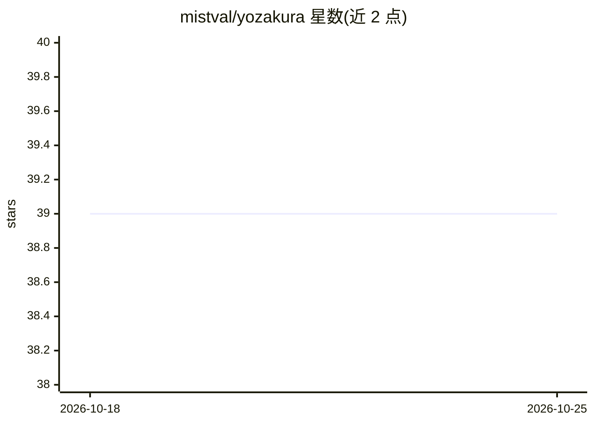

# mistval/yozakura

⭐ 39 · TypeScript · AGPL-3.0 · 推送 2026-10-25 · [GitHub](https://github.com/mistval/yozakura) · [官网](https://mistval.github.io/yozakura/) · 个人维护

**LLM 驱动的社交模拟引擎：多角色在地图上互动并生成记忆**

基于用户自选 LLM 的社交模拟应用：角色（含用户）在地图上移动、互相交互，形成对彼此的记忆与意图，随模拟推进产生动态演化的叙事，规模可从数十到上百角色。以 Electron 桌面应用或 Docker 镜像形式分发，也支持 git clone 源码方式运行（Node.js v24 与 Git 为源码运行的前置要求），开发模式通过 npm 分别安装 client 与 server 依赖并热重载运行。

## 筛选速览

| 维度 | 判定 | 备注 |
|---|---|---|
| AI 角色 | `ai-native` | 本体是模型或模型工具 |
| 许可风险 | `viral` | AGPL-3.0 |
| 部署形态 | `library` | 以包/库形式分发 |
| 模型依赖 | — | README 未给出锁定关系 |
| 硬件要求 | — | 无带数字的原话,不猜 |
| 安装摩擦 | `low` | 无编译、无系统依赖或容器化 |
| 成熟度 | — | 结构信号不足 |

## 能力要点

- 角色（含用户）在地图上移动并互相交互
- 角色间形成记忆与意图，叙事动态演化
- 支持数十到上百个角色规模
- 用户自选 LLM 驱动交互

## 适用场景

- 运行由 LLM 驱动的多角色社交模拟叙事
- 以玩家身份进入地图与 AI 角色互动
- 观察角色记忆与意图随时间演化形成的动态故事

## 场景标签

`多智能体` `Agent 记忆` · 领域:Agent 开发

## 证据(README 行号)

> L1: Yozakura is an AI-powered social simulation in which characters (including the user) move around a map, interact wit
> L5: If you want to use Yozakura, head to the getting started guide for download and installation instructions for the El

## 星数曲线

2026-10-18 39 → 2026-10-25 39（+0）

---
*卡片 v1 · prompt 1.4 · 生成 2026-10-25 · 置信度 high · 依据 README sha `dfb185bd6acf` · [字段定义](../../DATASET.md)*
