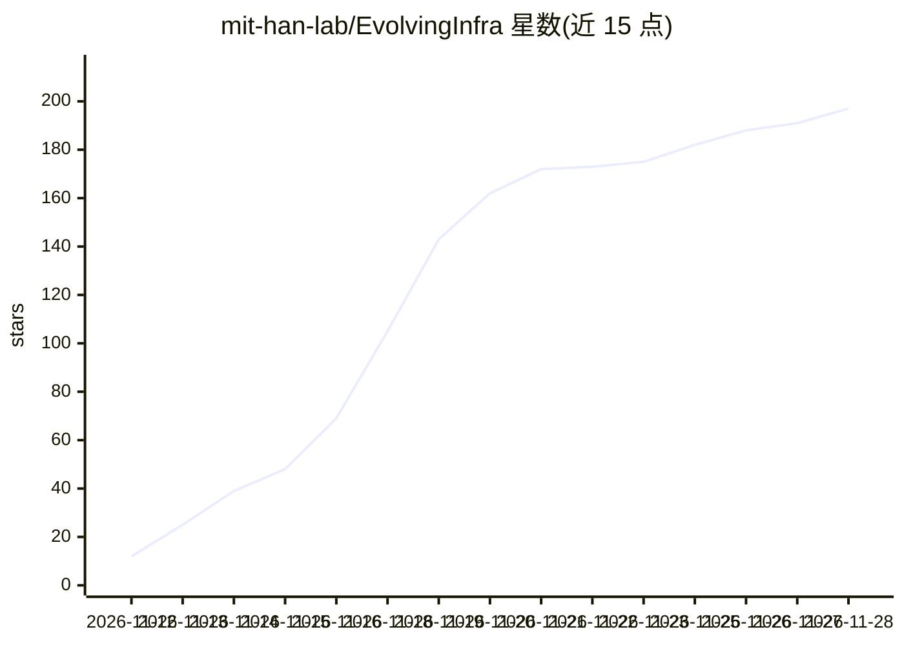

# mit-han-lab/EvolvingInfra

⭐ 197 · Python · NOASSERTION · 推送 2026-11-24 · [GitHub](https://github.com/mit-han-lab/EvolvingInfra) · [官网](https://inference-rsi.com/) · 组织维护

**面向 agent 工作负载的自适应 LLM 推理服务系统**

Evolving Infra 是一个针对 agent 工作负载在线自适应的 LLM serving 系统，无需离线 profiling。核心机制：将计算分配与 KV cache 管理解耦（节点秒级切换 prefill/decode 且不重启）、用覆盖子代理与上下文管理的成本模型预测负载并驱动规划器与路由器、以 agent 感知的分布式 KV 管理器决定 KV 的迁移与淘汰。引擎派生自 SGLang，路由核心为 Rust 实现，通过编码代理按 skill 完成部署、接入与基准复现。

## 筛选速览

| 维度 | 判定 | 备注 |
|---|---|---|
| AI 角色 | `ai-ecosystem` | LLM/agent 周边工具 |
| 许可风险 | `none` | NOASSERTION |
| 部署形态 | `None` |  |
| 模型依赖 | — | README 未给出锁定关系 |
| 硬件要求 | — | 无带数字的原话,不猜 |
| 安装摩擦 | `low` | 无编译、无系统依赖或容器化 |
| 成熟度 | `idea` | |

## 能力要点

- 解耦计算分配与 KV 管理，节点秒级切换 prefill/decode 且无需重启
- 覆盖子代理与上下文管理的负载预测成本模型驱动 planner 与 router
- agent 感知的分布式 KV 管理器按 agent 分支需求淘汰/保留 KV
- agent-native 仓库：由 Claude Code/Codex 等编码代理按 skill 部署与复现

## 适用场景

- 为编码、数学、computer-use 类 agent 提供推理服务
- 在多 GPU 集群上复现论文中的 agent 基准
- 将自有 agent 通过 API 接入以保留活跃分支的 KV cache

## 场景标签

`推理引擎` · 领域:训练与推理

## 证据(README 行号)

> L25: Evolving Infra is an LLM serving system that adapts itself to the agent workload **purely online**,
> L26: with **no offline profiling**. Serving coding, math and computer-use agents with GLM-5.2 and Kimi K2.6
> L98: |`evolving_infra/engine/`|Serving engine, derived from SGLang (`decoupled_engine`); what we changed|

## 星数曲线

2026-11-12 12 → 2026-11-28 197（+185）

---
*卡片 v1 · prompt 1.4 · 生成 2026-11-27 · 置信度 high · 依据 README sha `2c195b8768d2` · [字段定义](../../DATASET.md)*
