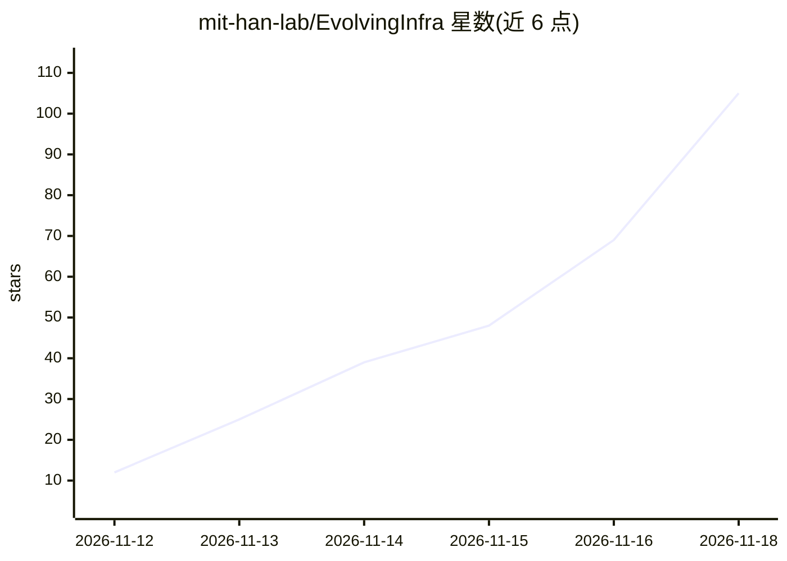

# mit-han-lab/EvolvingInfra

⭐ 105 · Python · NOASSERTION · 推送 2026-11-17 · [GitHub](https://github.com/mit-han-lab/EvolvingInfra) · [官网](https://inference-rsi.com/) · 组织维护

**面向 agent 工作负载自适应的 LLM 推理服务系统**

由 Georgia Tech、UIUC、UC Berkeley、NVIDIA、OpenAI、MIT 等机构研究者开发的 LLM serving 系统：面向编码、数学、计算机使用类 agent 的动态负载，通过三项设计在线自适应——将计算分配与 KV cache 管理解耦（节点秒级切换 prefill/decode 且无需重启）、用覆盖子 agent 与上下文管理的成本模型做负载预测与请求放置、agent 感知的分布式 KV 管理器驱动迁移与淘汰。服务引擎衍生自 SGLang，路由为 Rust 实现，通过 Docker 运行时镜像分发，部署与基准复现流程以技能文件形式交给编码 agent 执行。

## 筛选速览

| 维度 | 判定 | 备注 |
|---|---|---|
| AI 角色 | `ai-ecosystem` | LLM/agent 周边工具 |
| 许可风险 | `none` | NOASSERTION |
| 部署形态 | `None` |  |
| 模型依赖 | — | README 未给出锁定关系 |
| 硬件要求 | — | 无带数字的原话,不猜 |
| 安装摩擦 | `low` | 无编译、无系统依赖或容器化 |
| 成熟度 | — | 结构信号不足 |

## 能力要点

- 纯在线自适应，无需离线 profiling
- 计算分配与 KV cache 管理解耦，节点秒级切换 prefill/decode 无需重启
- 覆盖子 agent 与上下文管理的成本模型驱动规划与路由
- agent 感知的分布式 KV 管理器驱动 KV 迁移与淘汰

## 适用场景

- 为编码/数学/计算机使用类 agent 提供低延迟的 LLM 服务
- 在多 GPU 节点集群上动态适配变化的 agent 推理负载
- 复现论文中的 Claude Code / Putnam / OSWorld 基准结果

## 场景标签

`推理引擎` · 领域:训练与推理

## 证据(README 行号)

> L25: Evolving Infra is an LLM serving system that adapts itself to the agent workload **purely online**,
> L36: Evolving Infra adapts online through three designs:
> L98: |`evolving_infra/engine/`|Serving engine, derived from SGLang (`decoupled_engine`); what we changed|

## 星数曲线

2026-11-12 12 → 2026-11-18 105（+93）

---
*卡片 v1 · prompt 1.4 · 生成 2026-11-18 · 置信度 high · 依据 README sha `c45625304b75` · [字段定义](../../DATASET.md)*
