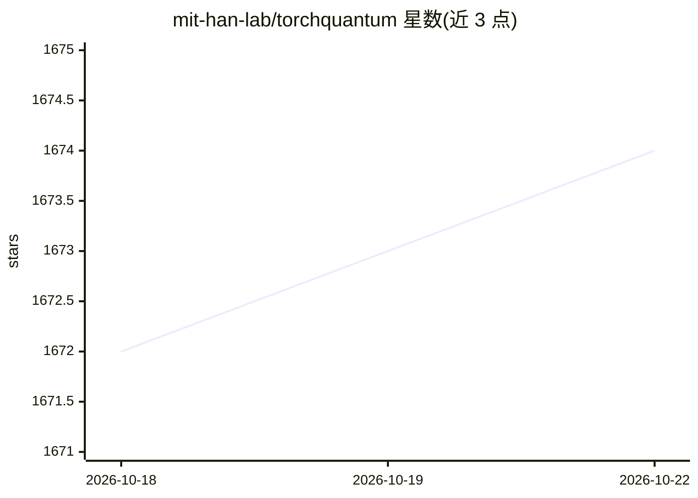

# mit-han-lab/torchquantum

⭐ 1,674 · Jupyter Notebook · MIT · 推送 2026-07-06 · [GitHub](https://github.com/mit-han-lab/torchquantum) · [官网](https://torchquantum.org) · 组织维护

**基于 PyTorch 的量子经典模拟与量子机器学习框架**

面向量子算法设计、量子机器学习与量子神经网络研究者的 PyTorch 框架：在经典硬件上做量子计算模拟，支持 GPU 上的态矢量模拟，可扩展到多 GPU 模拟 30+ 量子比特；提供动态计算图、autograd 梯度、CPU/GPU 批量训练、混合量子-经典模型构建，并可转换为 Qiskit 电路部署到 IBMQ 等真实量子设备。附带 VQE、MNIST 量子分类等示例与教程。依赖 Python 3.7-3.9 与 PyTorch≥1.8，GPU 训练需 NVIDIA GPU。

## 筛选速览

| 维度 | 判定 | 备注 |
|---|---|---|
| AI 角色 | `ai-ecosystem` | LLM/agent 周边工具 |
| 许可风险 | `permissive` | MIT |
| 部署形态 | `library` | 以包/库形式分发 |
| 模型依赖 | — | README 未给出锁定关系 |
| 硬件要求 | — | 无带数字的原话,不猜 |
| 安装摩擦 | `low` | 无编译、无系统依赖或容器化 |
| 成熟度 | — | 结构信号不足 |

## 能力要点

- GPU 态矢量模拟，多 GPU 可扩展至 30+ 量子比特
- 动态计算图与 autograd 梯度支持，CPU/GPU 批量训练
- 可转换到 Qiskit 并部署到 IBMQ 等真实量子设备
- 提供 QNN for MNIST、VQE、QAOA 等多层级示例教程

## 适用场景

- 训练参数化量子电路与量子神经网络模型
- 在经典 GPU 上模拟大规模量子计算
- 将训练好的量子电路部署到 IBM 真实量子计算机

## 场景标签

 · 领域:量子计算/量子机器学习

## 证据(README 行号)

> L41: Simulate quantum computations on classical hardware using PyTorch. It supports statevector simulation and pulse sim
> L44: Researchers on quantum algorithm design, parameterized quantum circuit training, quantum optimal control, quantum m
> L67: - Easy **deployment on real quantum devices** such as IBMQ

## 星数曲线

2026-10-18 1,672 → 2026-10-22 1,674（+2）

---
*卡片 v1 · prompt 1.4 · 生成 2026-10-21 · 置信度 mid · 依据 README sha `049f6e79bb7c` · [字段定义](../../DATASET.md)*
