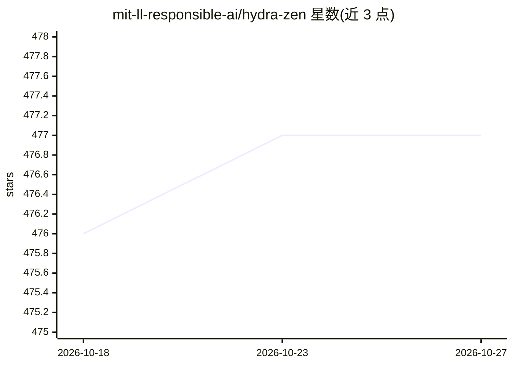

# mit-ll-responsible-ai/hydra-zen

⭐ 477 · Python · MIT · 推送 2026-10-23 · [GitHub](https://github.com/mit-ll-responsible-ai/hydra-zen) · [官网](https://mit-ll-responsible-ai.github.io/hydra-zen/) · 组织维护

**面向可复现工作流的 Hydra 配置库，免写 YAML 与样板代码**

基于 Hydra 的 Python 配置库，用于构建可配置、可复现、可扩展的研究级或生产级代码：通过函数动态自动生成基于 dataclass 的配置对象，替换手写 YAML；提供自定义 config-store API 与任务函数包装器以消除大部分 Hydra 样板代码。每次运行的完整配置可与结果一同保存，支持本地或集群多节点多次启动。依赖仅 hydra-core 与 typing-extensions，另提供 PyTorch Lightning 使用指南。

## 筛选速览

| 维度 | 判定 | 备注 |
|---|---|---|
| AI 角色 | `ai-ecosystem` | LLM/agent 周边工具 |
| 许可风险 | `permissive` | MIT |
| 部署形态 | `library` | 以包/库形式分发 |
| 模型依赖 | — | README 未给出锁定关系 |
| 硬件要求 | — | 无带数字的原话,不猜 |
| 安装摩擦 | `low` | 无编译、无系统依赖或容器化 |
| 成熟度 | — | 结构信号不足 |

## 能力要点

- 自动生成 dataclass 配置，消除手写 YAML
- 运行时自动保存完整配置实现可复现
- 支持本地与集群多节点多次启动
- 依赖仅为 hydra-core 与 typing-extensions

## 适用场景

- 为机器学习实验写出可从命令行配置的训练代码
- 让每次运行的配置随结果自动留档，便于复现
- 在集群上批量启动不同配置的实验

## 场景标签

 · 领域:软件工程/机器学习工程

## 证据(README 行号)

> L26:  A library that facilitates configurable, reproducible, and scalable workflows, using Hydra.
> L30:  Interested in machine learning? Check out our guide for using PyTorch Lightning with hydra-zen.⚡
> L38: **hydra-zen eliminates all hand-written yaml configs from your Hydra project**. It does so by providing functions t

## 星数曲线

2026-10-18 476 → 2026-10-27 477（+1）

---
*卡片 v1 · prompt 1.4 · 生成 2026-10-21 · 置信度 high · 依据 README sha `aaa2de9b49ec` · [字段定义](../../DATASET.md)*
