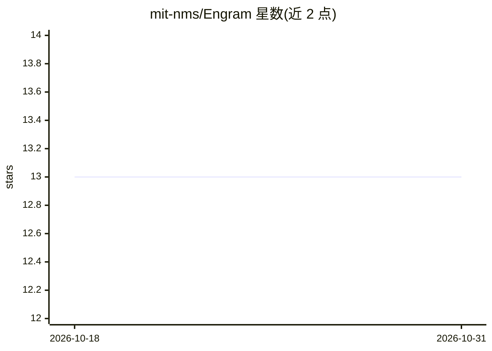

# mit-nms/Engram

⭐ 13 · Jupyter Notebook · MIT · 推送 2026-05-27 · [GitHub](https://github.com/mit-nms/Engram) · [官网](https://dl.acm.org/doi/10.1145/3786335.3813138) · 组织维护

**自主设计计算机系统算法的 agentic 研究架构（科研）**

MIT 团队开发的 agentic researcher 架构：给定问题描述与仿真环境，一系列 agent 迭代地编写代码、运行实验、分析结果并改进算法，产出可解释的算法。关键机制是持久化 Archive 与 Research Digest，由上一个 agent 蒸馏高层洞见传给下一个 agent，以缓解长上下文退化与并行运行知识不累积的问题。实现基于 LangChain 的 DeepAgents 库，代码在 Docker 容器中执行，需要 OpenAI API key。附带三个基准问题（多云组播、LLM 请求路由、KV 缓存复用）及基线方法对比，可接入自定义问题。

## 筛选速览

| 维度 | 判定 | 备注 |
|---|---|---|
| AI 角色 | `ai-native` | 本体是模型或模型工具 |
| 许可风险 | `permissive` | MIT |
| 部署形态 | `library` | 以包/库形式分发 |
| 模型依赖 | — | README 未给出锁定关系 |
| 硬件要求 | — | 无带数字的原话,不猜 |
| 安装摩擦 | `low` | 无编译、无系统依赖或容器化 |
| 成熟度 | — | 结构信号不足 |

## 能力要点

- Agent 间接力交接：Archive 归档工作区，Research Digest 传递高层洞见
- 基于 LangChain DeepAgents 实现，agent 可读写文件、执行 shell 与 run_simulation
- 内置多云组播/LLM 请求路由/KV 缓存复用三个基准，支持自定义问题评估器
- 包含 FunSearch、OpenEvolve 等基线方法与实验结果 Web 查看器

## 适用场景

- 让 agent 自动为网络/系统优化问题设计与迭代算法
- 复现论文中三个系统优化基准的实验
- 接入自定义仿真评估器，优化自己的系统问题

## 场景标签

`科研工具` · 领域:学习与行业

## 证据(README 行号)

> L14: Engram is an agentic researcher architecture that **autonomously designs algorithms** for computer systems. Given a
> L35: Engram is implemented using the DeepAgents library in LangChain. Each agent has access to DeepAgents tools (filesys
> L91: Engram is evaluated on three core problems in the paper:

## 星数曲线

2026-10-18 13 → 2026-10-31 13（+0）

---
*卡片 v1 · prompt 1.4 · 生成 2026-10-31 · 置信度 mid · 依据 README sha `5f96188c228b` · [字段定义](../../DATASET.md)*
