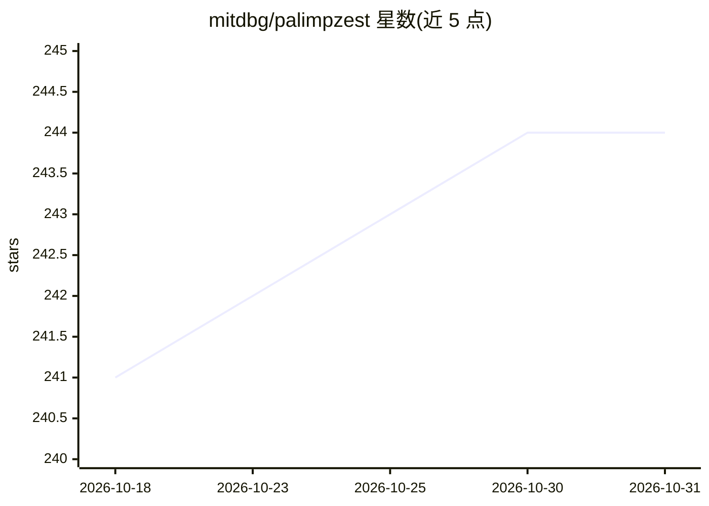

# mitdbg/palimpzest

⭐ 244 · Python · MIT · 推送 2026-09-17 · [GitHub](https://github.com/mitdbg/palimpzest) · [官网](https://palimpzest.org/) · 组织维护

**面向非结构化数据的声明式语义计算与优化系统**

Palimpzest（PZ）是一个语义计算系统：用声明式查询方式对非结构化数据（文档等）执行由 LLM 驱动的处理管线（语义算子），并配有基于代价的优化器 Abacus 对语义算子计划做优化。面向构建数据处理/分析管线的开发者，由 MIT 数据库组团队维护。提供 PyPI 包（pip/uv 安装）或源码安装，附 Colab Demo、完整文档与社区 Discord；有 CIDR 2025 论文与 Abacus 优化器论文可引用。

## 筛选速览

| 维度 | 判定 | 备注 |
|---|---|---|
| AI 角色 | `ai-ecosystem` | LLM/agent 周边工具 |
| 许可风险 | `permissive` | MIT |
| 部署形态 | `library` | 以包/库形式分发 |
| 模型依赖 | — | README 未给出锁定关系 |
| 硬件要求 | — | 无带数字的原话,不猜 |
| 安装摩擦 | `low` | 无编译、无系统依赖或容器化 |
| 成熟度 | — | 结构信号不足 |

## 能力要点

- 声明式查询方式执行 LLM 驱动的语义算子管线
- 基于代价的优化器 Abacus 优化语义算子计划
- 提供 PyPI 包、Colab Demo 与完整文档

## 适用场景

- 用声明式方式对非结构化文档做 LLM 分析管线
- 研究语义算子系统的查询优化
- 需要优化 AI 分析负载成本的 数据团队构建处理流程

## 场景标签

`文档解析` `数据分析` · 领域:效率与自动化

## 证据(README 行号)

> L46:     title={Palimpzest: Optimizing AI-Powered Analytics with Declarative Query Processing},
> L56:       title={Abacus: A Cost-Based Optimizer for Semantic Operator Systems},

## 星数曲线

2026-10-18 241 → 2026-10-31 244（+3）

---
*卡片 v1 · prompt 1.4 · 生成 2026-10-22 · 置信度 mid · 依据 README sha `d4bcaa0cf623` · [字段定义](../../DATASET.md)*
