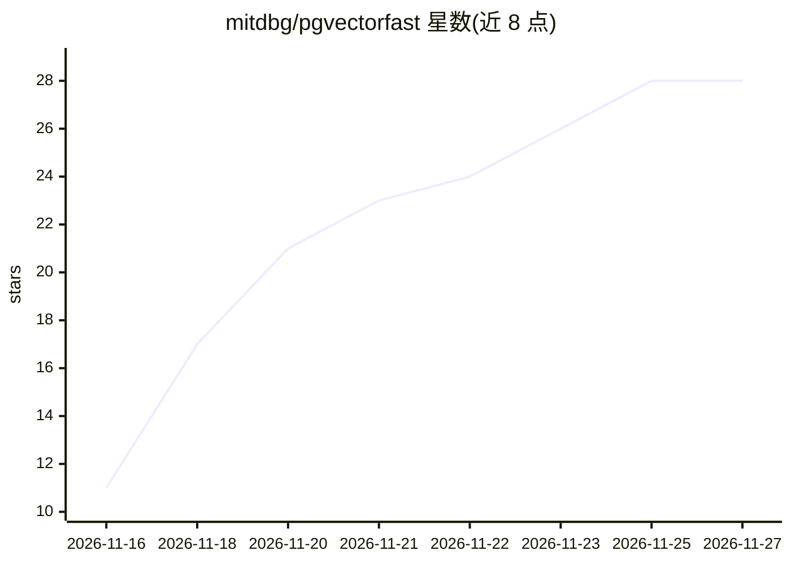

# mitdbg/pgvectorfast

⭐ 28 · C · NOASSERTION · 推送 2026-11-19 · [GitHub](https://github.com/mitdbg/pgvectorfast) · 组织维护

**加速 pgvector 向量检索的 PostgreSQL 扩展（Calico 缓冲池）**

基于 pgvector 的 PostgreSQL 扩展，用 Calico 缓冲池替换 PostgreSQL 默认共享缓冲管理器，加速向量相似度搜索与分析查询。机制包括数组式页面翻译与路径缓存、无锁乐观读、HNSW 图遍历的分组预取（CPU 预取与 io_uring 异步读）。保持与 pgvector 数据类型、距离算子和索引类型的 SQL 与磁盘兼容。要求 Linux x86-64、PostgreSQL 18/19 与非 LTO 构建；提供 Docker 镜像、Debian APT 包、PGXN 与源码编译四种安装途径，需以 shared_preload_libraries 预加载。

## 筛选速览

| 维度 | 判定 | 备注 |
|---|---|---|
| AI 角色 | `ai-ecosystem` | LLM/agent 周边工具 |
| 许可风险 | `none` | NOASSERTION |
| 部署形态 | `self-host` | docker 或自建部署 |
| 模型依赖 | — | README 未给出锁定关系 |
| 硬件要求 | — | 无带数字的原话,不猜 |
| 安装摩擦 | `low` | 无编译、无系统依赖或容器化 |
| 成熟度 | — | 结构信号不足 |

## 能力要点

- 以 Calico 缓冲池替换 PostgreSQL 默认缓冲管理器
- 与 pgvector 数据类型/算子/索引（hnsw、ivfflat）保持 SQL 与磁盘兼容
- HNSW 遍历的无锁乐观读与分组预取（calico.optimistic_reads、hnsw.enable_prefetch）
- 提供 Docker、APT、PGXN、源码编译四种安装方式

## 适用场景

- 在现有 pgvector 数据库上以扩展方式加速向量检索
- 内存不足场景下运行 HNSW 向量搜索
- 需要保持 pgvector SQL 兼容的 RAG 知识库检索加速

## 场景标签

`向量数据库` · 领域:知识与检索

## 证据(README 行号)

> L2:  pgvectorfast is a high-performance drop-in enhancement for pgvector that accelerates vector similarity search and a
> L22: pgvectorfast replaces PostgreSQL's shared buffer manager with the **Calico** buffer pool (*Making Array-Based Trans

## 星数曲线

2026-11-16 11 → 2026-11-27 28（+17）

---
*卡片 v1 · prompt 1.4 · 生成 2026-11-18 · 置信度 high · 依据 README sha `6a3f486966b1` · [字段定义](../../DATASET.md)*
