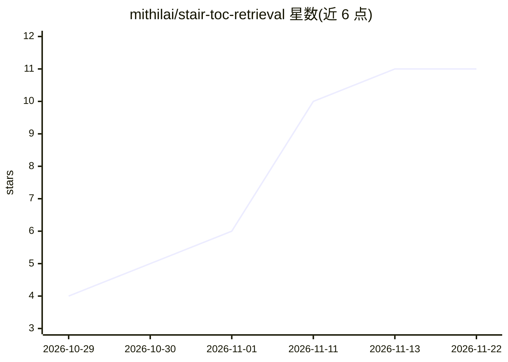

# mithilai/stair-toc-retrieval

⭐ 11 · Python · MIT · 推送 2026-09-20 · [GitHub](https://github.com/mithilai/stair-toc-retrieval) · [官网](https://medium.com/@mithilmaske/i-built-stair-from-scratch-a-retriever-that-returns-section-names-not-chunk-ids-22882a7b4cd8) · 个人维护

**面向研究者的生成式检索复现：返回真实章节标题而非 chunk ID**

STAIR（STructure Aware Information Retriever）的独立复现实现：以文档目录（ToC）作为文档标识符，训练 Mistral-7B + QLoRA 将目录加问题映射到真实章节标题；推理输出经 trie 约束解码，仅允许生成真实存在的章节标题，作者测量幻觉率为 0.00%。索引存于模型权重，无向量数据库，新增文档需重新训练。面向想研究或扩展 STAIR 的人群；作者声明仅评估了一本书、4 epochs，结果为该代码库的工作基线，不能与论文数值对比。

## 筛选速览

| 维度 | 判定 | 备注 |
|---|---|---|
| AI 角色 | `ai-native` | 本体是模型或模型工具 |
| 许可风险 | `permissive` | MIT |
| 部署形态 | `desktop` | 安装包/桌面程序 |
| 模型依赖 | — | README 未给出锁定关系 |
| 硬件要求 | — | 无带数字的原话,不猜 |
| 安装摩擦 | `medium` | 含编译或系统依赖之一 |
| 成熟度 | `idea` | |

## 能力要点

- 生成式检索直接输出章节标题（如 "Brain Cells: Neurons"）而非 chunk ID
- trie 约束解码使引用不存在章节在结构上不可能
- Mistral-7B 4-bit QLoRA 训练峰值 5.01 GB VRAM，可在 8 GB 消费级显卡运行
- 提供显著性检验脚本与基准基准缺失查询率审计

## 适用场景

- 研究结构感知生成式检索（DSI/ToC 标识符）并在其上扩展
- 对比 ToC 标识符与 BM25/无 ToC 基线的检索效果
- 学习带约束解码的 LLM 微调流程（QLoRA、trie 约束）

## 场景标签

`微调` · 领域:训练与推理

## 证据(README 行号)

> L11: A retriever that returns section names, not chunk IDs. A table of contents feeds a fine-tuned Mistral-7B model whos
> L39: **Training** runs once per book. Task 1 (ingestion) memorises the corpus into the parameters. Task 2 (retrieval) te

## 星数曲线

2026-10-29 4 → 2026-11-22 11（+7）

---
*卡片 v1 · prompt 1.4 · 生成 2026-11-18 · 置信度 high · 依据 README sha `907eae1f9b38` · [字段定义](../../DATASET.md)*
