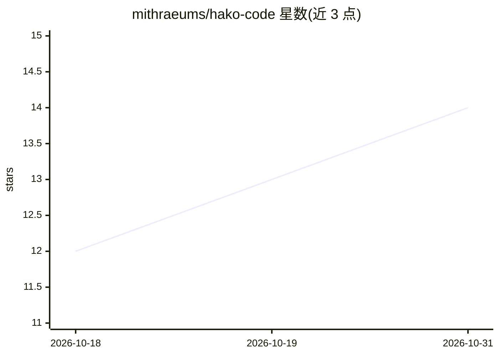

# mithraeums/hako-code

⭐ 14 · C · GPL-3.0 · 推送 2026-10-30 · [GitHub](https://github.com/mithraeums/hako-code) · [官网](https://mithraeum.studio) · 个人维护

**单 C 文件实现的终端编程 Agent，本地模型优先、多提供商**

以约 650 KB 的 C99 单文件形式提供的终端编程 Agent，链接 libc 与 pthread，需 PATH 上有 curl，不依赖 Node/Python 运行时。默认检测本地 hako 引擎模型（hako-sho 3B / hako-koi 7B）离线运行，另接入 Anthropic（OAuth）、OpenAI 兼容通道等 14 个云提供商。功能包括按调用逐次审批的工具集（读/写/编辑/Shell 等，写入前显示 diff）、SKILL.md 格式技能加载（兼容 .claude/skills）、HAKO.md 项目上下文、70% 窗口时折叠中段的上下文管理、JSON 输出的脚本模式与工具调用基准测试、经端到端加密中继的手机远程会话。提供 curl 安装脚本或 gcc 单行编译，支持 macOS/Linux/FreeBSD/Windows/iSh 五个平台。

## 筛选速览

| 维度 | 判定 | 备注 |
|---|---|---|
| AI 角色 | `ai-native` | 本体是模型或模型工具 |
| 许可风险 | `viral` | GPL-3.0 |
| 部署形态 | `None` |  |
| 模型依赖 | local-ok | 支持本地模型 |
| 硬件要求 | — | 无带数字的原话,不猜 |
| 安装摩擦 | `high` | 编译与系统依赖俱全 |
| 成熟度 | — | 结构信号不足 |

## 能力要点

- C99 单文件编译，产物约 650 KB，仅链接 libc/pthread，需 curl 于 PATH
- 本地 hako 引擎默认运行 3B/7B 模型，无 key 无云；ollama 为可选独立提供商
- 工具按调用逐次审批（y/n/a），写入前展示 diff；项目需 :trust 解锁
- 兼容开放 Agent Skills 标准，读取 .hako/.claude/.agents 多处技能目录

## 适用场景

- 在终端用自然语言驱动读写文件、执行 Shell 的编程任务
- 无 Node/Python 环境的机器上运行轻量本地模型编程助手
- 复用已为 Claude 类 agent 写好的 SKILL.md 技能与 CLAUDE.md 上下文
- 通过手机端到端加密远程接管终端中的会话

## 场景标签

`编码 Agent` · 领域:编码与开发

## 证据(README 行号)

> L7:  A coding agent in one C file. ~650 KB, no runtime, no package manager. Runs offline on a model you own — and on a p
> L28:  Local first. Auto-defaults to any installed hako model — <code>hako-sho</code> (3B) or <code>hako-koi</code> (7B),
> L80: - **14 cloud providers when you want them.** Anthropic native (SSE + OAuth via Claude Pro/Max), ChatGPT sign-in (an

## 星数曲线

2026-10-18 12 → 2026-10-31 14（+2）

---
*卡片 v1 · prompt 1.4 · 生成 2026-10-31 · 置信度 high · 依据 README sha `da29044899c1` · [字段定义](../../DATASET.md)*
