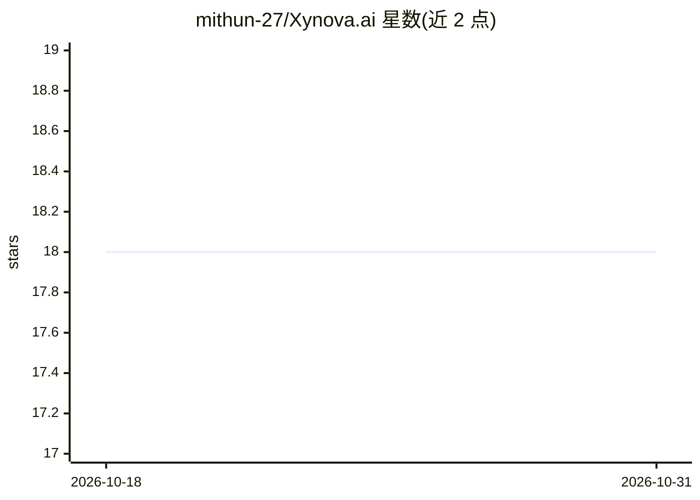

# mithun-27/Xynova.ai

⭐ 18 · TypeScript · 推送 2026-08-08 · [GitHub](https://github.com/mithun-27/Xynova.ai) · [官网](https://xynova.web.app) · 组织维护

**AI 个性化学习平台：生成任意学科学习路线图并辅导**

面向学生的个性化学习平台：输入学科或上传文档（.txt/.pdf/.docx）生成结构化学习路线图，提供上下文感知的 AI 导师对话与进度分析。技术栈为 React 18 + Vite 前端、FastAPI 后端、Celery + Redis 后台任务处理路线图生成、Supabase PostgreSQL 存储，LLM 通过 OpenRouter API 接入；已部署线上版本（Firebase/Render）。本地开发需 Node.js、Python 3.11+ 与 Docker Compose 启动 PostgreSQL/Redis，MIT 许可。

## 筛选速览

| 维度 | 判定 | 备注 |
|---|---|---|
| AI 角色 | `ai-native` | 本体是模型或模型工具 |
| 许可风险 | `none` | — |
| 部署形态 | `desktop` | 安装包/桌面程序 |
| 模型依赖 | — | README 未给出锁定关系 |
| 硬件要求 | — | 无带数字的原话,不猜 |
| 安装摩擦 | `low` | 无编译、无系统依赖或容器化 |
| 成熟度 | — | 结构信号不足 |

## 能力要点

- 基于学科或上传文档（.txt/.pdf/.docx）生成个性化学习路线图
- 上下文感知的 AI 导师对话问答
- Celery + Redis 后台生成路线图，JWT 认证与进度分析
- 通过 OpenRouter API 接入 LLM

## 适用场景

- 上传课程大纲或教材生成定制学习路线
- 通过 AI 导师对话深入理解知识点
- 跟踪各课程与测验的掌握进度

## 场景标签

`文档问答` · 领域:知识与检索

## 证据(README 行号)

> L7: **Xynova.ai** is a state-of-the-art personalized learning platform that engineers custom roadmaps for any subject. P
> L20: - 🎯 **AI Roadmap Generation** — Personalized learning paths based on your subject or uploaded documents (.txt, .pdf
> L22: - 💬 **AI Tutor** — Context-aware chat assistant for deep explanations and Q&A.

## 星数曲线

2026-10-18 18 → 2026-10-31 18（+0）

---
*卡片 v1 · prompt 1.4 · 生成 2026-10-29 · 置信度 high · 依据 README sha `023013524fe9` · [字段定义](../../DATASET.md)*
