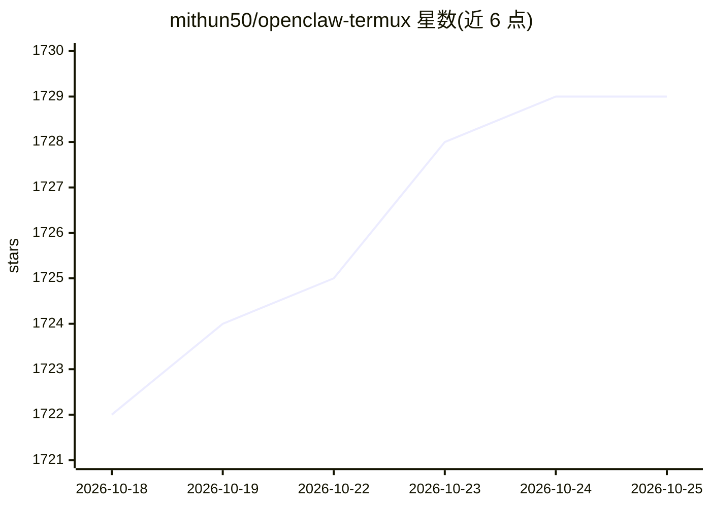

# mithun50/openclaw-termux

⭐ 1,729 · Dart · MIT · 推送 2026-10-14 · [GitHub](https://github.com/mithun50/openclaw-termux) · [官网](https://github.com/mithun50/openclawd-termux#readme) · 个人维护

**在 Android 上运行 OpenClaw AI 网关的 Flutter 应用与 Termux CLI**

提供两种方式在 Android 设备上运行 OpenClaw AI 网关：独立 Flutter 应用（内置终端、WebView 仪表盘、一键安装 proot Ubuntu + Node.js 22 + OpenClaw）和 Termux CLI 包（openclawx 命令）。支持配置 9 家 AI 提供商（Anthropic/OpenAI/Gemini/OpenRouter/DeepSeek/Ollama 等）的 API key 与模型选择；应用可作为 node 节点把摄像头、位置、传感器等 9 项 Android 硬件能力（21 条命令）经 WebSocket 暴露给 AI。需 Android 10+，首次安装约下载 500MB；可选安装 Go/Homebrew/OpenSSH 并支持 SSH 远程访问。

## 筛选速览

| 维度 | 判定 | 备注 |
|---|---|---|
| AI 角色 | `ai-ecosystem` | LLM/agent 周边工具 |
| 许可风险 | `permissive` | MIT |
| 部署形态 | `library` | 以包/库形式分发 |
| 模型依赖 | local-ok | 支持本地模型 |
| 硬件要求 | — | 无带数字的原话,不猜 |
| 安装摩擦 | `low` | 无编译、无系统依赖或容器化 |
| 成熟度 | — | 结构信号不足 |

## 能力要点

- Flutter 应用一键安装 proot Ubuntu + Node.js 22 + OpenClaw，无需 root
- 9 家 AI 提供商的 API key 与模型配置（含 Ollama/DeepSeek/OpenRouter）
- 作为 node 暴露 9 项 Android 硬件能力（21 条命令）供 AI 调用
- Termux CLI 提供 openclawx 命令行与一键安装脚本

## 适用场景

- 在 Android 手机上长期运行 OpenClaw AI 网关
- 让 AI 调用手机摄像头、位置、传感器等设备能力
- 通过 SSH 从电脑远程管理手机上的网关环境

## 场景标签

`模型网关` · 领域:Agent 开发

## 证据(README 行号)

> L14: > Run **OpenClaw AI Gateway** on Android - standalone Flutter app with built-in terminal, web dashboard, optional d
> L46: ## What is OpenClaw?
> L66: - **AI Providers** - Configure API keys and select models for 9 providers (Anthropic, OpenAI, Google Gemini, OpenRo

## 星数曲线

2026-10-18 1,722 → 2026-10-25 1,729（+7）

---
*卡片 v1 · prompt 1.4 · 生成 2026-10-21 · 置信度 high · 依据 README sha `8cedfc88ec07` · [字段定义](../../DATASET.md)*
