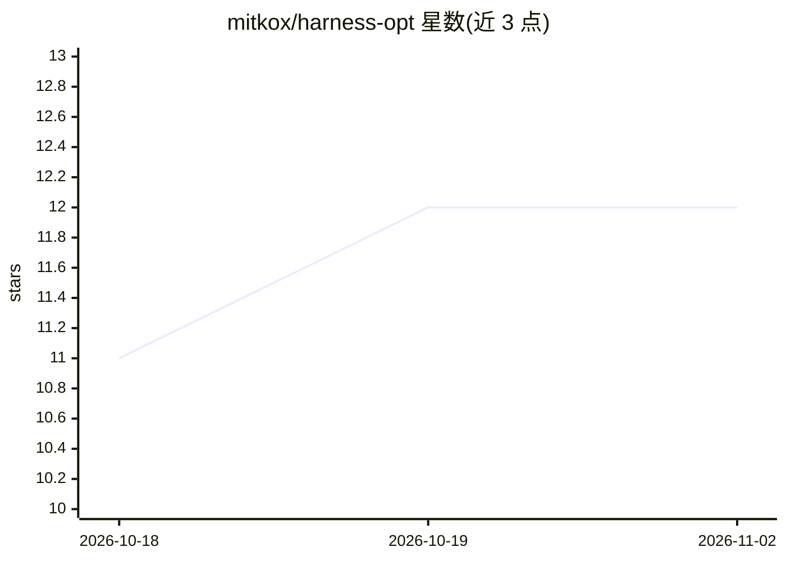

# mitkox/harness-opt

⭐ 12 · Python · Apache-2.0 · 推送 2026-10-11 · [GitHub](https://github.com/mitkox/harness-opt) · 个人维护

**本地编码 agent 配置的评测与优化 CLI 工具**

面向单人本地开发场景的 CLI 工具：将模型部署、harness、提示词、技能与运行时配置绑定为不可变执行包，运行 Pi 等编码 agent harness 于隔离工作区（bwrap 命名空间、loopback 推理、cgroup 限额），记录轨迹并由独立进程的可信验证器判定结果，输出遥测（OpenTelemetry）与 APM 导出。仅限本地模型（DeepSeek/Qwen/GLM），无云端回退；当前仅实现 Pi 适配器，自动优化、激活与回滚均为规划项。通过 git clone 与 wheelhouse 脚本安装。

## 筛选速览

| 维度 | 判定 | 备注 |
|---|---|---|
| AI 角色 | `ai-ecosystem` | LLM/agent 周边工具 |
| 许可风险 | `permissive` | Apache-2.0 |
| 部署形态 | `None` |  |
| 模型依赖 | — | README 未给出锁定关系 |
| 硬件要求 | — | 无带数字的原话,不猜 |
| 安装摩擦 | `low` | 无编译、无系统依赖或容器化 |
| 成熟度 | `idea` | |

## 能力要点

- 模型+harness+提示词+技能绑定不可变执行包并记录 bundle 摘要
- 独立进程可信验证器判定 pass/fail，agent 自述不决定结果
- bwrap 命名空间隔离、loopback 推理代理、cgroup v2 限额
- OpenTelemetry 本地遥测与 APM 导出（带来源与往返校验）

## 适用场景

- 在本地评估不同模型/harness/提示词组合的编码任务表现
- 对编码 agent 运行做可复现的轨迹记录与可信验证
- 离线环境下构建可追溯的 agent 配置评测证据

## 场景标签

`模型评测` `LLM 可观测性` · 领域:评测与运维

## 证据(README 行号)

> L9: HOP evaluates and eventually optimizes complete local coding-agent
> L34: HOP operates **above** harnesses such as:
> L41: It does not replace their agent loops. It wraps their headless interfaces,

## 星数曲线

2026-10-18 11 → 2026-11-02 12（+1）

---
*卡片 v1 · prompt 1.4 · 生成 2026-11-01 · 置信度 high · 依据 README sha `676693f7090f` · [字段定义](../../DATASET.md)*
