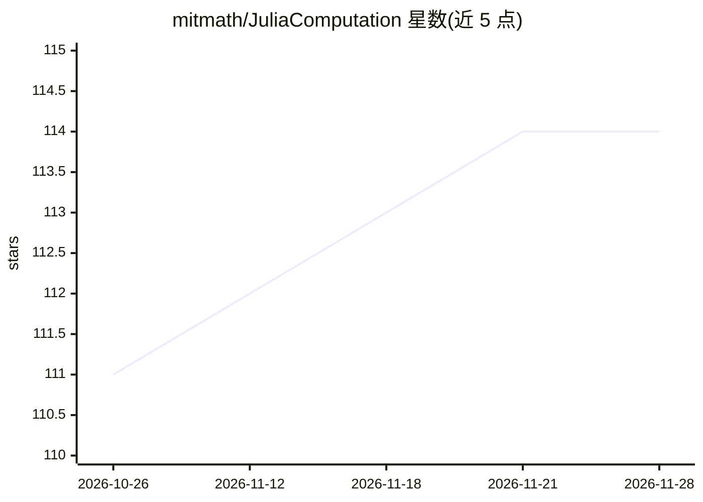

# mitmath/JuliaComputation

⭐ 114 · HTML · 推送 2026-11-23 · [GitHub](https://github.com/mitmath/JuliaComputation) · [官网](https://computationalthinking.mit.edu) · 组织维护

**MIT 2026 秋季 Julia 计算课程资料：交互式笔记本学科学计算**

MIT 数学系 Fall 2026 课程 Common Ground C25 的资料仓库，由 Alan Edelman 主讲，跨六个系编号。内容以 Pluto 交互式笔记本为主，覆盖自动微分、Navier-Stokes、气候建模、图像变换、期权定价、排队论等主题，官网提供可在线操作滑块与代码的互动讲义。课程实验性规定学生可借助 LLM 学习超前提内容并撰写笔记本进行研讨式讲授；作业与日历、历届学生报告笔记均在仓库中列出。仓库标注为建设中（work in progress）。

## 筛选速览

| 维度 | 判定 | 备注 |
|---|---|---|
| AI 角色 | `ai-knowledge` | 知识聚合/清单类 |
| 许可风险 | `none` | — |
| 部署形态 | `None` |  |
| 模型依赖 | — | README 未给出锁定关系 |
| 硬件要求 | — | 无带数字的原话,不猜 |
| 安装摩擦 | `low` | 无编译、无系统依赖或容器化 |
| 成熟度 | — | 结构信号不足 |

## 能力要点

- 全套 Pluto 交互式笔记本，含自动微分、气候与海洋建模、贝叶斯因果推断等专题
- 课程允许并鼓励使用 LLM 辅助学习与撰写笔记本（L25-L30）
- 多数笔记本同时提供静态 HTML 快照便于阅读，本地运行需 Julia 环境
- 作业涵盖双数、前向/反向模式自动微分与 Jacobians（L59-L60）

## 适用场景

- 自学 Julia 与科学计算，跟着笔记本做交互式实验
- 参考他人如何用笔记本讲清气候模型、期权定价等应用主题
- 借鉴把 LLM 融入教学的课程设计

## 场景标签

`教程课程` · 领域:学习与行业

## 证据(README 行号)

> L1: # Julia: Solving Real-World Problems with Computation, Fall 2026 *(course material work in progress)*
> L10: > # Check out our interactive lecture material on computationalthinking.mit.edu!
> L25: 2. LLMs can help us leapfrog our learning.

## 星数曲线

2026-10-26 111 → 2026-11-28 114（+3）

---
*卡片 v1 · prompt 1.4 · 生成 2026-11-28 · 置信度 high · 依据 README sha `88c8f2e4058f` · [字段定义](../../DATASET.md)*
