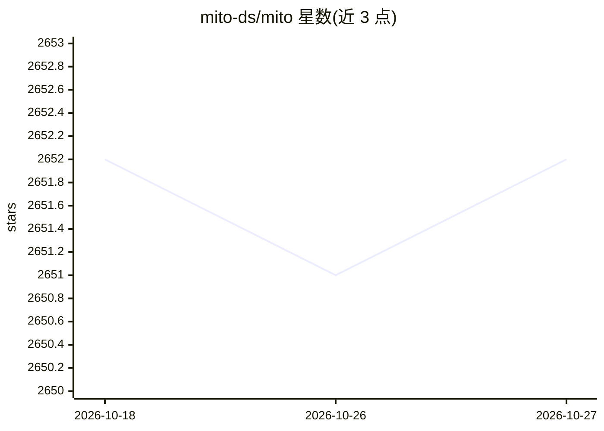

# mito-ds/mito

⭐ 2,652 · Jupyter Notebook · NOASSERTION · 推送 2026-07-21 · [GitHub](https://github.com/mito-ds/mito) · [官网](https://trymito.io) · 组织维护

**Jupyter 扩展套件：AI 聊天补全 + 生成代码的电子表格**

由公司团队维护的 Jupyter 扩展集合，含三个部分：Mito AI 提供上下文感知的 AI 聊天与报错调试，减少在 Jupyter 与外部聊天工具间的复制粘贴；Mito Spreadsheet 提供交互式电子表格界面，支持 VLOOKUP 公式、筛选、透视表与图表，每次编辑自动转换为 Python 代码；另提供 Streamlit/Dash 组件，用两行代码向仪表盘添加电子表格。通过 pip 安装，支持 JupyterLab 4.0；开源版之外另有付费 Mito Pro。

## 筛选速览

| 维度 | 判定 | 备注 |
|---|---|---|
| AI 角色 | `ai-enhanced` | 去掉 AI 部分产品仍成立 |
| 许可风险 | `none` | NOASSERTION |
| 部署形态 | `library` | 以包/库形式分发 |
| 模型依赖 | — | README 未给出锁定关系 |
| 硬件要求 | — | 无带数字的原话,不猜 |
| 安装摩擦 | `low` | 无编译、无系统依赖或容器化 |
| 成熟度 | — | 结构信号不足 |

## 能力要点

- 上下文感知的 AI 聊天与报错调试扩展
- 电子表格操作（公式/筛选/透视表/图表）自动生成 Python 代码
- Streamlit/Dash 两行代码集成电子表格组件

## 适用场景

- 在 Jupyter 中用电子表格方式探索数据并得到等价 Python 代码
- 在 Jupyter 内直接使用 AI 聊天调试代码，不用切换到外部工具
- 给 Streamlit/Dash 仪表盘快速加电子表格功能

## 场景标签

`数据分析` `代码生成` · 领域:效率与自动化

## 证据(README 行号)

> L16: Mito is a set of Jupyter extensions desgined to help you write Python code faster. There are 3 main pieces of Mito.
> L18: 2. Mito Spreadsheet: Explore your data in an interactive spreadsheet interface. Write spreadsheet formulas like VLO

## 星数曲线

2026-10-18 2,652 → 2026-10-27 2,652（+0）

---
*卡片 v1 · prompt 1.4 · 生成 2026-10-21 · 置信度 high · 依据 README sha `1dd273d1e971` · [字段定义](../../DATASET.md)*
