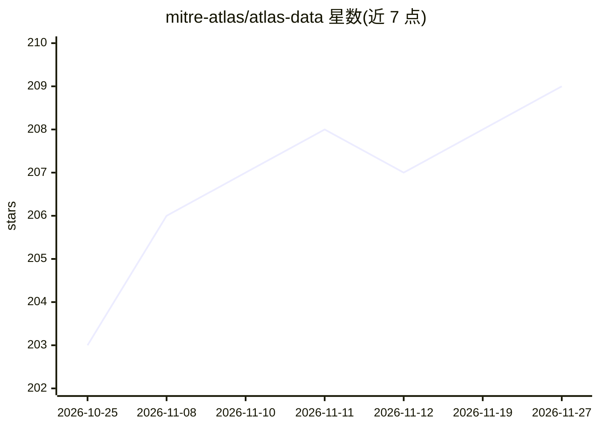

# mitre-atlas/atlas-data

⭐ 209 · Python · NOASSERTION · 推送 2026-10-28 · [GitHub](https://github.com/mitre-atlas/atlas-data) · [官网](https://atlas.mitre.org) · 组织维护

**面向 AI 安全从业者：ATLAS 对抗 AI 系统 TTP 知识库的数据与工具**

MITRE ATLAS 的权威数据仓库：分发针对 AI 系统的对手战术与技术（TTP）、案例研究、缓解措施的 YAML 数据文件，附带解析、校验与管理工具。仓库内含 Pydantic 模式定义的 REST API 用于编辑数据，CLI 工具可将 YAML 导入数据库、生成 STIX 2.1 Attack Flow、Navigator 层与 Excel 格式，并按月发布内容版本与格式版本分离的数据。通过 uv 安装依赖，pytest 校验发布数据。

## 筛选速览

| 维度 | 判定 | 备注 |
|---|---|---|
| AI 角色 | `ai-knowledge` | 知识聚合/清单类 |
| 许可风险 | `none` | NOASSERTION |
| 部署形态 | `None` |  |
| 模型依赖 | — | README 未给出锁定关系 |
| 硬件要求 | — | 无带数字的原话,不猜 |
| 安装摩擦 | `low` | 无编译、无系统依赖或容器化 |
| 成熟度 | — | 结构信号不足 |

## 能力要点

- 分发 ATLAS 权威 YAML 数据：Matrix/Tactic/Technique/Mitigation/Case Study/Entity/Software 对象
- 提供 REST API 作为数据编写工具，支持导入、编辑、导出 YAML
- CLI 生成 STIX 2.1 Attack Flow bundle，支持按案例研究筛选
- 按内容版本（YYYY.MM）与格式版本（SEMVER）双轨版本管理，附 manifest 映射

## 适用场景

- 查询针对 AI 系统的攻击战术、技术与真实案例研究
- 为安全评估导入 STIX/Navigator 格式的 ATLAS 数据
- 参与或审阅 ATLAS 数据的贡献编辑流程

## 场景标签

`网络安全` · 领域:学习与行业

## 证据(README 行号)

> L3: This repository distributes data for MITRE ATLAS&trade; (Adversarial Threat Landscape for AI Systems), a public know
> L7: The ATLAS YAML files in this repository are the authoritative source of ATLAS data. The database and REST API suppor
> L34: - `atlas/` - ATLAS Python package containing Pydantic schemas and REST API

## 星数曲线

2026-10-25 203 → 2026-11-27 209（+6）

---
*卡片 v1 · prompt 1.4 · 生成 2026-11-26 · 置信度 high · 依据 README sha `56d8d4901736` · [字段定义](../../DATASET.md)*
