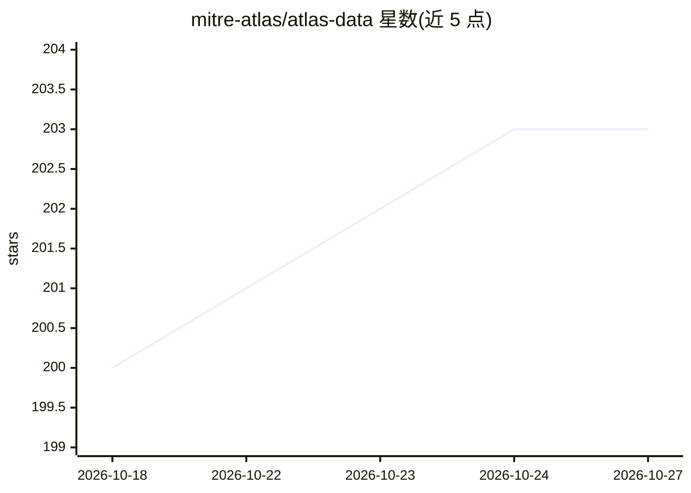

# mitre-atlas/atlas-data

⭐ 203 · Python · NOASSERTION · 推送 2026-09-15 · [GitHub](https://github.com/mitre-atlas/atlas-data) · [官网](https://atlas.mitre.org) · 组织维护

**MITRE ATLAS 威胁知识库数据仓库：AI 系统攻防 TTP 数据与工具**

发布 MITRE ATLAS（面向 AI 系统的对抗威胁全景）知识库数据：战术、技术、缓解措施、案例研究及其类型化关系，以 YAML 格式按内容版本（YYYY.MM.N）与格式版本（SEMVER）双轨发布。附带 Python 包（Pydantic schema）、基于 SQLite 与 FastAPI 的 REST API 用于数据管理，以及生成 STIX、Excel、ATT&CK Navigator 图层的命令行工具。面向 AI 安全研究与防御分析人员，由 MITRE 维护并按月更新内容。

## 筛选速览

| 维度 | 判定 | 备注 |
|---|---|---|
| AI 角色 | `ai-knowledge` | 知识聚合/清单类 |
| 许可风险 | `none` | NOASSERTION |
| 部署形态 | `None` |  |
| 模型依赖 | — | README 未给出锁定关系 |
| 硬件要求 | — | 无带数字的原话,不猜 |
| 安装摩擦 | `low` | 无编译、无系统依赖或容器化 |
| 成熟度 | — | 结构信号不足 |

## 能力要点

- ATLAS 战术/技术/缓解/案例研究数据及类型化关系（achieves/mitigates/employs 等）
- Pydantic schema 校验 + FastAPI REST API（SQLite 存储）管理数据
- 命令行工具生成 STIX、Excel、Navigator 图层分发格式
- 内容版本与格式版本双轨版本化，月度更新

## 适用场景

- 查询针对 AI 系统的对手战术与技术
- 将 ATLAS 数据导入安全工具链（STIX/Navigator）做威胁建模
- 基于 REST API 二次开发 ATLAS 数据管理应用

## 场景标签

`网络安全` · 领域:学习与行业

## 证据(README 行号)

> L3: This repository distributes data for MITRE ATLAS&trade; (Adversarial Threat Landscape for AI Systems), a public know
> L31: - `dist/` - distributed ATLAS data files and the release manifest.

## 星数曲线

2026-10-18 200 → 2026-10-27 203（+3）

---
*卡片 v1 · prompt 1.4 · 生成 2026-10-22 · 置信度 high · 依据 README sha `86d40f32fa5c` · [字段定义](../../DATASET.md)*
