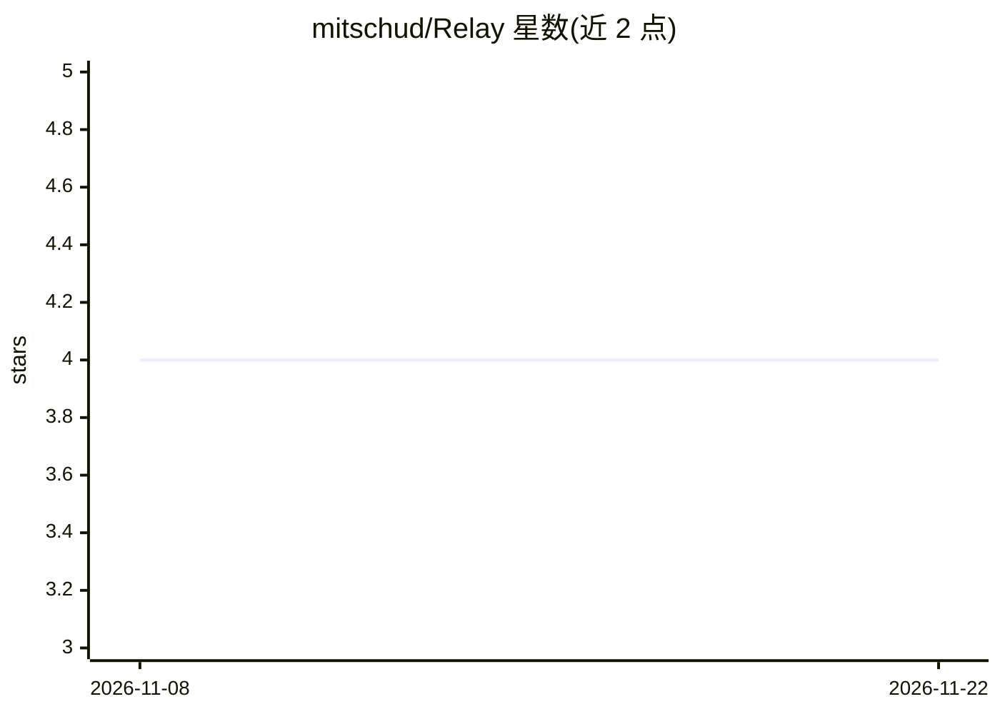

# mitschud/Relay

⭐ 4 · Rust · MIT · 推送 2026-11-16 · [GitHub](https://github.com/mitschud/Relay) · 个人维护

**面向开发者的本地 AI 编码 agent 原生桌面管理界面**

基于 Rust + egui 的 Linux 桌面应用，为本地编码 agent 提供前端与管理层：连接并管理 Codex agent 运行时与 Strata 本地推理服务，提供工作目录、工具调用审批、会话与模型生命周期控制、文件差异查看、上下文压缩与四级访问权限控制。不捆绑模型，也不替代推理引擎或 agent 运行时。当前仅源码构建，需 Rust/Cargo 工具链与已配置的 Strata 服务。

## 筛选速览

| 维度 | 判定 | 备注 |
|---|---|---|
| AI 角色 | `ai-ecosystem` | LLM/agent 周边工具 |
| 许可风险 | `permissive` | MIT |
| 部署形态 | `None` |  |
| 模型依赖 | — | README 未给出锁定关系 |
| 硬件要求 | — | 无带数字的原话,不猜 |
| 安装摩擦 | `medium` | 含编译或系统依赖之一 |
| 成熟度 | — | 结构信号不足 |

## 能力要点

- 单一 Rust 可执行文件，无内嵌浏览器或 JavaScript 前端
- 管理 Codex app-server 会话：工具活动、审批、文件 diff 查看
- 通过 Strata 端点连接本地模型，支持模型服务启停与配置档管理
- 四级 agent 访问模式（只读/审批/完全/完全+sudo）

## 适用场景

- 在本地用自选模型运行编码 agent 修改项目文件
- 对 agent 在本机执行命令设置分级权限审批
- 统一管理模型服务启停、会话记录与持久记忆

## 场景标签

`编码 Agent` · 领域:编码与开发

## 证据(README 行号)

> L15: Relay is a native frontend and management layer for a **local, tool-using coding agent**. Rather than stopping at a
> L19: - **Relay** provides the desktop UI, session controls, model lifecycle management, native helpers, and supervision.
> L23: Relay does **not** bundle a model or replace the Strata inference engine or Codex agent runtime. It connects and ma

## 星数曲线

2026-11-08 4 → 2026-11-22 4（+0）

---
*卡片 v1 · prompt 1.4 · 生成 2026-11-21 · 置信度 high · 依据 README sha `c2932692da68` · [字段定义](../../DATASET.md)*
