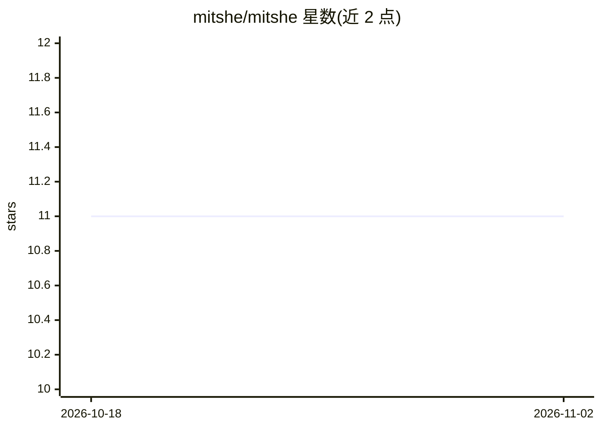

# mitshe/mitshe

⭐ 11 · TypeScript · MIT · 推送 2026-05-10 · [GitHub](https://github.com/mitshe/mitshe) · [官网](https://mitshe.com) · 组织维护

**AI 编码 agent 的自托管工作区管理器：每任务一个隔离 Docker 线程**

自托管的开源平台，为 AI 编码 agent 提供工作区管理：每个任务在独立 Docker 容器中运行，内置 Claude Code、终端、浏览器（noVNC 流式 Chrome）与 git，可像标签页一样切换线程。功能含分支管理与 PR 创建、环境快照复用、Jira→线程→Slack 的工作流自动化、Claude Code 斜杠命令技能导入，多模型供应商 BYOK（Claude/OpenAI/OpenRouter/Gemini/Groq）。通过 curl 脚本或 Docker 手动安装，另有 macOS/Windows/Linux 桌面客户端连接实例。

## 筛选速览

| 维度 | 判定 | 备注 |
|---|---|---|
| AI 角色 | `ai-ecosystem` | LLM/agent 周边工具 |
| 许可风险 | `permissive` | MIT |
| 部署形态 | `self-host` | docker 或自建部署 |
| 模型依赖 | locked-api |  |
| 硬件要求 | — | 无带数字的原话,不猜 |
| 安装摩擦 | `low` | 无编译、无系统依赖或容器化 |
| 成熟度 | — | 结构信号不足 |

## 能力要点

- 每任务独立 Docker 容器（终端/浏览器/文件编辑器/git）
- noVNC 流式 Chrome 与可视化 Playwright 测试
- 工作流自动化：Jira issue → 建线程 → Claude Code → 通知 Slack
- 多供应商 BYOK：Claude/OpenAI/OpenRouter/Gemini/Groq

## 适用场景

- 并行处理多个 AI 编码任务而不互相污染 git 分支
- 把配置好的环境存为快照复用为新线程基础
- 将 Jira/Slack 与 AI 编码线程串成自动化流程

## 场景标签

`编码 Agent` `工作流自动化` · 领域:效率与自动化

## 证据(README 行号)

> L3: > Workspace manager for AI coding agents.
> L9: Every task gets its own thread — an isolated Docker container with Claude Code, terminal, browser, and git. Switch b
> L57: - **Threads** — isolated Docker containers per task, with terminal, browser, file editor, git

## 星数曲线

2026-10-18 11 → 2026-11-02 11（+0）

---
*卡片 v1 · prompt 1.4 · 生成 2026-11-02 · 置信度 high · 依据 README sha `d0e77ec68d44` · [字段定义](../../DATASET.md)*
