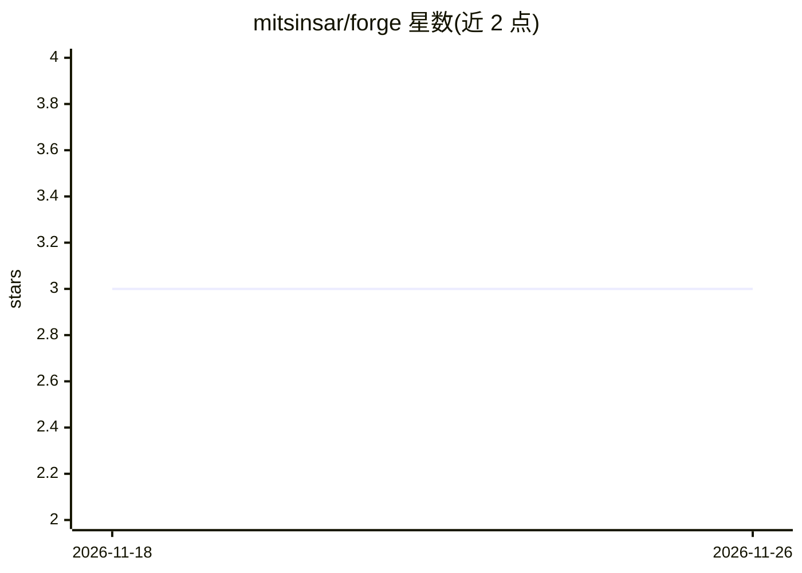

# mitsinsar/forge

⭐ 3 · Python · Apache-2.0 · 推送 2026-11-19 · [GitHub](https://github.com/mitsinsar/forge) · 个人维护

**游戏开发者：一句话文本生成绑定动画的 3D 角色资产**

本地运行的文本转游戏资产流水线：输入一句描述，经图片、网格、动画三道人工审核关卡（各由本地视觉模型辅助检查），产出带贴图、LOD、骨骼与动画的可用资产，直接导入 Unity（FBX、动画控制器、prefab）或 Godot（SpriteFrames、tscn）。可批量 autopilot 生成最多 20 个资产，提供 HTTP API 与 WebSocket 进度。要求单张 24GB+ VRAM 的 NVIDIA GPU，依赖 LM Studio、ComfyUI、Hunyuan3D 2.1、UniRig、Blender 等本地工具。

## 筛选速览

| 维度 | 判定 | 备注 |
|---|---|---|
| AI 角色 | `ai-native` | 本体是模型或模型工具 |
| 许可风险 | `permissive` | Apache-2.0 |
| 部署形态 | `None` |  |
| 模型依赖 | — | README 未给出锁定关系 |
| 硬件要求 | `gpu-24g` | |
| 安装摩擦 | `low` | 无编译、无系统依赖或容器化 |
| 成熟度 | — | 结构信号不足 |

## 能力要点

- 文本生成带骨骼绑定与动画剪辑的游戏资产，支持 6 种体型
- 三道审核关卡由本地视觉模型自动检查并触发重做
- 支持 SDXL/Qwen-Image/Flux 风格配置文件与批量 autopilot
- HTTP API 覆盖全部功能，WebSocket 实时进度

## 适用场景

- 为独立游戏批量生成角色、装备与武器资产
- 生成配套的技能特效 flipbook 与精灵图集
- 在浏览器中微调关节后重新绑定骨骼

## 场景标签

 · 领域:游戏开发/生成式 AI

## 证据(README 行号)

> L4: Text → game-ready, rigged and animated 3D assets, on your own GPU.
> L18: project. Everything runs **locally on one NVIDIA GPU**; no cloud service, no per-asset fees, and

## 星数曲线

2026-11-18 3 → 2026-11-26 3（+0）

---
*卡片 v1 · prompt 1.4 · 生成 2026-11-26 · 置信度 high · 依据 README sha `48b5a30bfbac` · [字段定义](../../DATASET.md)*
