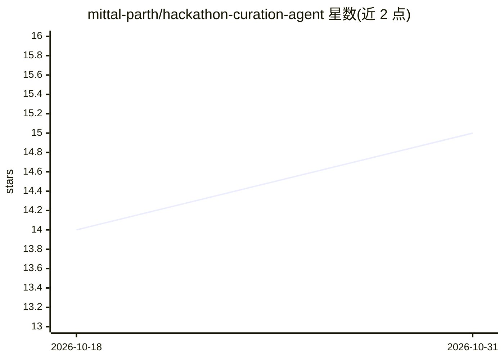

# mittal-parth/hackathon-curation-agent

⭐ 15 · Python · AGPL-3.0 · 推送 2026-05-03 · [GitHub](https://github.com/mittal-parth/hackathon-curation-agent) · [官网](https://webclub.nitk.ac.in/hackclub_nitk) · 组织维护

**从 Gmail 通讯中自动筛选招 Hackathon 并推送到表格与 Twitter 的 AI 代理**

用 Python 编写的自动化代理：监控指定 Gmail 标签下的邮件，提取 Hackathon 链接，调用 Google Gemini（结合 Google Search Grounding）实时分析日期、奖金、主题与合法性，按可配置标准筛选后存入 Google Sheets（含去重），并自动发布到 Twitter、发送摘要邮件。运行方式为本地脚本或 GitHub Actions 定时执行，需配置 Gmail、Gemini、Sheets、Twitter 四类 API 凭据，筛选标准由 criteria.yaml 定义。

## 筛选速览

| 维度 | 判定 | 备注 |
|---|---|---|
| AI 角色 | `ai-native` | 本体是模型或模型工具 |
| 许可风险 | `viral` | AGPL-3.0 |
| 部署形态 | `library` | 以包/库形式分发 |
| 模型依赖 | — | README 未给出锁定关系 |
| 硬件要求 | — | 无带数字的原话,不猜 |
| 安装摩擦 | `low` | 无编译、无系统依赖或容器化 |
| 成熟度 | — | 结构信号不足 |

## 能力要点

- Gemini 结合 Google Search Grounding 实时分析 Hackathon 链接
- 筛选标准通过 criteria.yaml 可配置（最低奖金、偏好主题等）
- Google Sheets 存储含重复检测，自动发帖 Twitter 并发送摘要邮件
- 支持 GitHub Actions 自动运行与 DRY_RUN 测试模式

## 适用场景

- 我不想逐封翻邮件，让代理自动汇总值得参加的 Hackathon
- 把筛选结果集中到 Google Sheet 方便查阅和去重
- 自动在 Twitter 分享精选的 Hackathon 信息

## 场景标签

`工作流自动化` · 领域:效率与自动化

## 证据(README 行号)

> L3: An intelligent agent that automatically curates hackathons from your email newsletters, evaluates them using AI, and
> L17: 2. **AI Analysis and Curation**: Uses Google Gemini along with Grouding with Google Search to analyze hackathon URL

## 星数曲线

2026-10-18 14 → 2026-10-31 15（+1）

---
*卡片 v1 · prompt 1.4 · 生成 2026-10-30 · 置信度 mid · 依据 README sha `f6e137abec21` · [字段定义](../../DATASET.md)*
