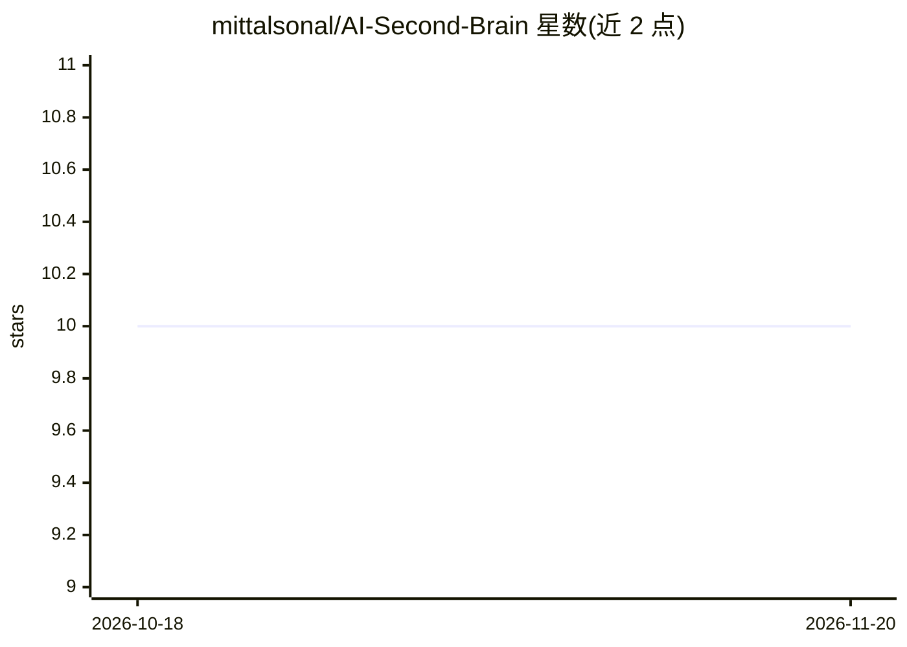

# mittalsonal/AI-Second-Brain

⭐ 10 · TypeScript · 推送 2026-06-16 · [GitHub](https://github.com/mittalsonal/AI-Second-Brain) · 个人维护

**个人 AI 知识助手：基于 RAG 回答笔记与文档问题**

全栈个人知识助手：笔记与 PDF/DOCX/TXT 文档存入 MongoDB，经分块与 Sentence Transformers 生成向量嵌入，查询时以余弦相似度检索相关片段，交由 Ollama（LLaMA3）生成回答。回答采用混合逻辑：命中个人笔记则引用来源，未命中则回退到通用知识并明确提示。附带笔记/文档摘要与多条问题合并处理。前端 Next.js + TypeScript，后端 FastAPI。README 未提供认证与多用户隔离，列为未来改进项。

## 筛选速览

| 维度 | 判定 | 备注 |
|---|---|---|
| AI 角色 | `ai-native` | 本体是模型或模型工具 |
| 许可风险 | `none` | — |
| 部署形态 | `library` | 以包/库形式分发 |
| 模型依赖 | local-ok | 支持本地模型 |
| 硬件要求 | — | 无带数字的原话,不猜 |
| 安装摩擦 | `low` | 无编译、无系统依赖或容器化 |
| 成熟度 | — | 结构信号不足 |

## 能力要点

- 混合 RAG 回答：个人笔记优先，未命中时回退通用知识并透明提示
- Sentence Transformers 语义检索与余弦相似度匹配
- 支持 PDF/DOCX/TXT 上传、分块与提问
- 笔记与文档的 AI 摘要

## 适用场景

- 对自己的笔记和文档进行问答
- 上传 PDF 等文件后针对内容提问
- 生成笔记和文档的摘要

## 场景标签

`知识库管理` `RAG` `文档问答` · 领域:知识与检索

## 证据(README 行号)

> L12: - 🤖 AI Q&A (Hybrid RAG System)
> L60: ### 3. Retrieval (RAG)
> L84: - A RAG pipeline for retrieving relevant personal context

## 星数曲线

2026-10-18 10 → 2026-11-20 10（+0）

---
*卡片 v1 · prompt 1.4 · 生成 2026-11-19 · 置信度 high · 依据 README sha `988ceee5f7df` · [字段定义](../../DATASET.md)*
