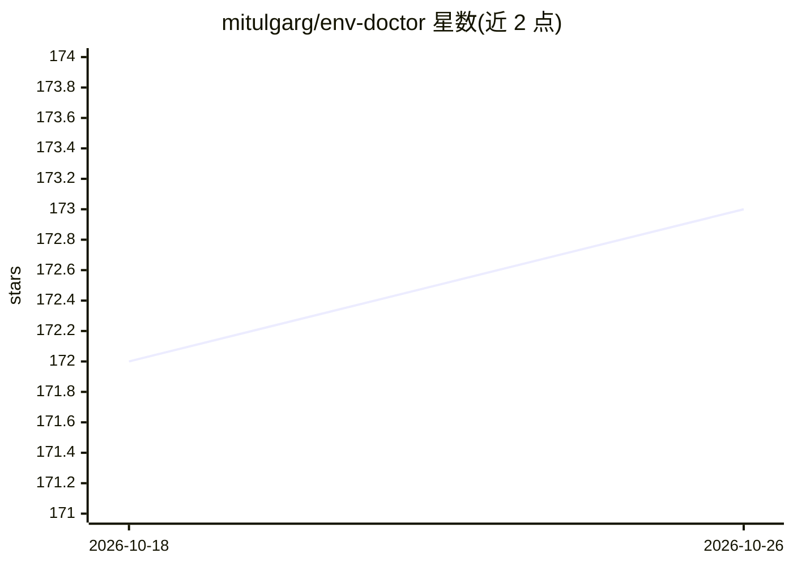

# mitulgarg/env-doctor

⭐ 173 · Python · MIT · 推送 2026-10-01 · [GitHub](https://github.com/mitulgarg/env-doctor) · [官网](https://mitulgarg.github.io/env-doctor/) · 个人维护

**诊断并修复 CUDA/GPU 环境兼容性问题的 CLI 与 MCP 工具**

面向 GPU 计算开发者的环境诊断 CLI：检测 NVIDIA 驱动、CUDA Toolkit、cuDNN、PyTorch/TensorFlow/JAX 之间的版本与算力架构（如 Blackwell）不匹配问题，并给出或执行修复（安全 pip 安装命令、CUDA Toolkit 安装、vLLM/SGLang/flash-attn 等扩展包的版本解析）。另含模型显存兼容检查（自动从 HuggingFace 拉取参数元数据）、Dockerfile/docker-compose 校验、Jupyter 内嵌 HTML 报告、面向 Claude 等 AI 助手的 MCP 服务器（11 个诊断工具），以及可选的 Fleet Dashboard 多机 Web 监控。核心 CLI 无重依赖，pip 秒装。

## 筛选速览

| 维度 | 判定 | 备注 |
|---|---|---|
| AI 角色 | `ai-ecosystem` | LLM/agent 周边工具 |
| 许可风险 | `permissive` | MIT |
| 部署形态 | `self-host` | docker 或自建部署 |
| 模型依赖 | — | README 未给出锁定关系 |
| 硬件要求 | — | 无带数字的原话,不猜 |
| 安装摩擦 | `low` | 无编译、无系统依赖或容器化 |
| 成熟度 | — | 结构信号不足 |

## 能力要点

- 驱动→CUDA→cuDNN→AI 库全链路兼容性诊断与算力架构（sm 架构）检查
- CUDA Auto-Installer 与针对 vLLM/SGLang/flash-attn 等的版本解析安装命令
- 内置 MCP 服务器向 Claude Code/Claude Desktop 等 AI 助手暴露 11 个诊断工具
- 模型显存需求检查（HuggingFace 自动拉取）与 Dockerfile GPU 配置校验

## 适用场景

- 排查 PyTorch CUDA 报错、torch.cuda.is_available() 为 False 等环境问题
- 在安装前确认驱动能支持的 vLLM/SGLang/flash-attn 版本组合
- CI/CD 中用 JSON 输出与退出码自动校验 GPU 环境与 Dockerfile
- 通过 Claude 等 AI 助手直接调用 GPU 诊断能力

## 场景标签

`MLOps` · 领域:训练与推理

## 证据(README 行号)

> L32: **Env-Doctor diagnoses and fixes the #1 frustration in GPU computing:** mismatched CUDA versions between your NVIDI
> L44: |**One-Command Diagnosis**|Check compatibility: GPU Driver → CUDA Toolkit → cuDNN → PyTorch/TensorFlow/JAX|
> L97: Env-Doctor includes a built-in Model Context Protocol (MCP) server that exposes 11 diagnostic tools to AI assistant

## 星数曲线

2026-10-18 172 → 2026-10-26 173（+1）

---
*卡片 v1 · prompt 1.4 · 生成 2026-10-22 · 置信度 mid · 依据 README sha `40c90ea51ec1` · [字段定义](../../DATASET.md)*
