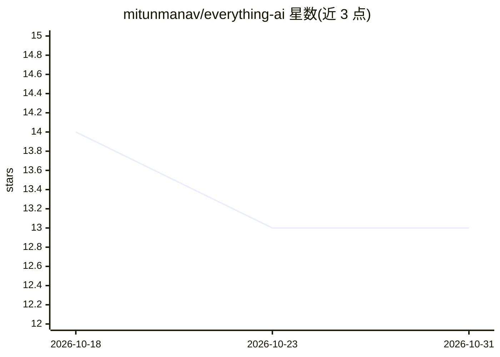

# mitunmanav/everything-ai

⭐ 13 · Python · MIT · 推送 2026-07-10 · [GitHub](https://github.com/mitunmanav/everything-ai) · 个人维护

**Codex agent 技能：把模糊指令转为专家范围与安全默认**

面向 Codex/Claude 类编码 agent 的技能包（SKILL.md 形式）。用户下达 do everything 等模糊目标后，技能让 agent 推断缺失范围、选择可逆的安全默认、先做无阻塞的工作再提问，并在付费/破坏性/高风险操作前暂停请求批准，最后报告已核查/已修改/缺失/未知项与置信度。内置 10 个领域包（编码、创业、研究、金融、健康等）。通过 npx 从 GitHub 安装，安装器不发送遥测、不读取密钥。附带双模型双盲评审的测试报告（单次运行结果）。

## 筛选速览

| 维度 | 判定 | 备注 |
|---|---|---|
| AI 角色 | `ai-ecosystem` | LLM/agent 周边工具 |
| 许可风险 | `permissive` | MIT |
| 部署形态 | `library` | 以包/库形式分发 |
| 模型依赖 | — | README 未给出锁定关系 |
| 硬件要求 | — | 无带数字的原话,不猜 |
| 安装摩擦 | `low` | 无编译、无系统依赖或容器化 |
| 成熟度 | — | 结构信号不足 |

## 能力要点

- 从模糊目标推断专家检查清单与安全默认
- 付费/破坏性/高风险操作前暂停等待批准
- 10 个领域包：编码、创业、研究、金融、健康等
- npx 从 GitHub 安装，支持 --dry-run 预检，不覆盖已有安装

## 适用场景

- 我想直接说'全部搞定'，让 agent 自己补全专家级范围
- 非技术用户希望 AI 端到端处理任务但高风险操作要留确认
- 让 agent 输出已核查/已修改/缺失项与置信度的证明报告

## 场景标签

`提示工程` · 领域:Agent 开发

## 证据(README 行号)

> L7: Everything AI is an agent skill for people who want AI to do everything.
> L11: You say `do everything`, `handle it end-to-end`, or `whatever is needed`. The promise: the AI figures out the exper

## 星数曲线

2026-10-18 14 → 2026-10-31 13（-1）

---
*卡片 v1 · prompt 1.4 · 生成 2026-10-31 · 置信度 mid · 依据 README sha `94b7dddb2bb5` · [字段定义](../../DATASET.md)*
