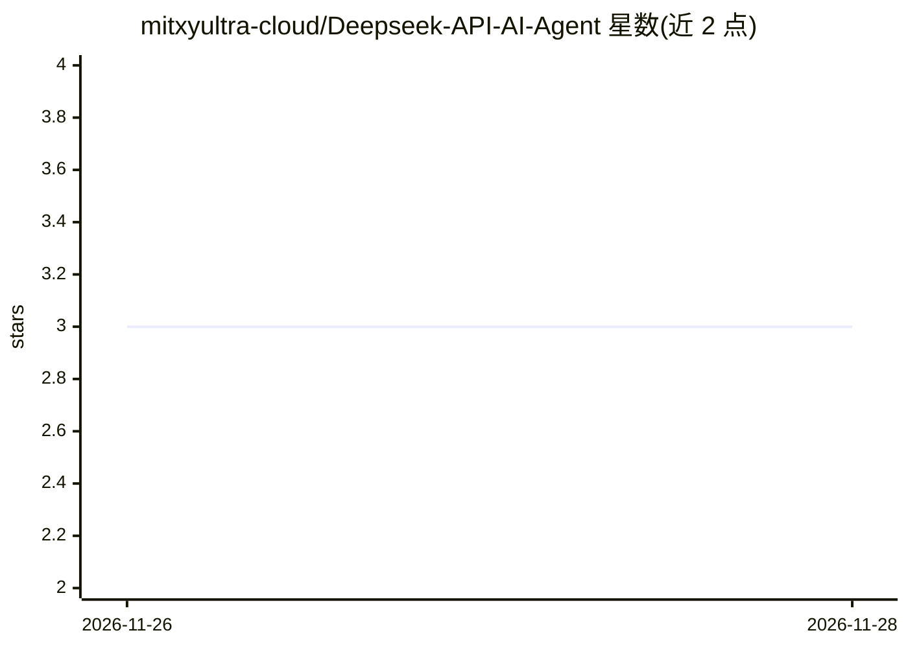

# mitxyultra-cloud/Deepseek-API-AI-Agent

⭐ 3 · TypeScript · MIT · 推送 2026-10-16 · [GitHub](https://github.com/mitxyultra-cloud/Deepseek-API-AI-Agent) · 个人维护

**把 DeepSeek 网页账号转为 OpenAI 兼容 API 的网关代理**

开源网关代理项目，将 chat.deepseek.com 的个人网页账号转换为标准 OpenAI 格式 API（/v1/chat/completions、/v1/models），使 DeepSeek-V4 与 R1 模型可在第三方聊天客户端与 IDE 工具中调用，无需付费 API key。机制包括浏览器扩展一键提取 Cookie/Token 认证、Playwright 自动登录、多账号池轮询分摊额度、WebAssembly 模块求解 Proof-of-Work。附带端口 20999 的 Web Dashboard 管理账号、密钥、日志与模型路由。以 Python 3.10+ / FastAPI 实现，README 声明仅供研究学习与个人用途。

## 筛选速览

| 维度 | 判定 | 备注 |
|---|---|---|
| AI 角色 | `ai-ecosystem` | LLM/agent 周边工具 |
| 许可风险 | `permissive` | MIT |
| 部署形态 | `library` | 以包/库形式分发 |
| 模型依赖 | locked-api |  |
| 硬件要求 | — | 无带数字的原话,不猜 |
| 安装摩擦 | `low` | 无编译、无系统依赖或容器化 |
| 成熟度 | — | 结构信号不足 |

## 能力要点

- OpenAI 兼容端点：/v1/chat/completions 与 /v1/models
- 浏览器扩展一键提取 Cookie/Token，Playwright 自动登录保存会话
- 多账号池自动分发负载与均衡限额，Wasm 模块解 PoW
- 端口 20999 的 Web Dashboard 管理账号、密钥、日志与模型路由

## 适用场景

- 把 DeepSeek 网页账号接入 NextChat、LobeChat、Chatbox 等客户端
- 在 Cursor、Cline 等 IDE 工具中通过自定义 base_url 调用 DeepSeek 模型
- 管理多个 DeepSeek 账号并自动均衡调用额度

## 场景标签

`模型网关` · 领域:Agent 开发

## 证据(README 行号)

> L21: **DeepSeek-API-AI-Agent** (thường gọi là **DeepSeek 2API**) là giải pháp cầu nối (gateway proxy) mã nguồn mở, biến 
> L23: Dự án cho phép bạn sử dụng mô hình **DeepSeek-V4** và **DeepSeek-R1 (DeepThink)** trong mọi công cụ, IDE và ứng dụn

## 星数曲线

2026-11-26 3 → 2026-11-28 3（+0）

---
*卡片 v1 · prompt 1.4 · 生成 2026-11-26 · 置信度 high · 依据 README sha `a6209944c9e6` · [字段定义](../../DATASET.md)*
