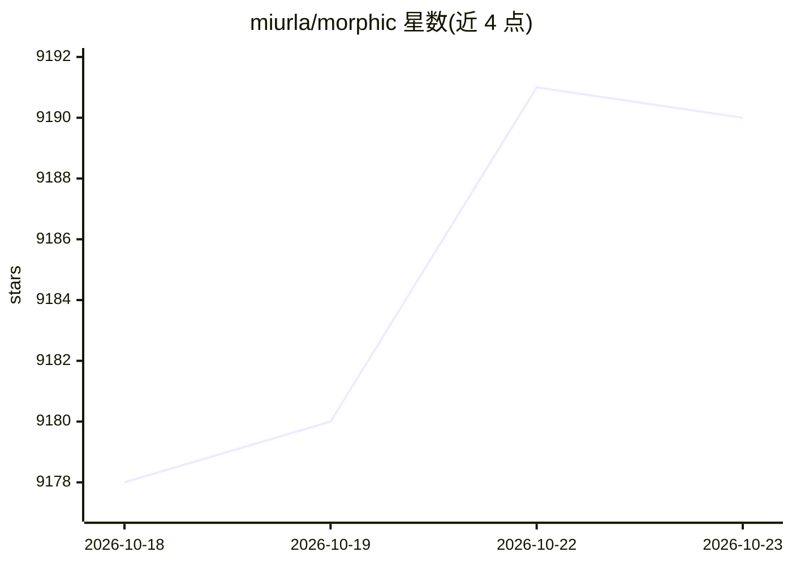

# miurla/morphic

⭐ 9,190 · TypeScript · Apache-2.0 · 推送 2026-10-21 · [GitHub](https://github.com/miurla/morphic) · [官网](https://chat.morphic.sh) · 个人维护

**带生成式 UI 的 AI 搜索引擎（自托管 Web 应用）**

基于 Next.js/TypeScript 构建的 AI 搜索引擎 Web 应用：用户提问后返回带引用来源的回答，并通过流式 JSON 规格实时渲染富内联组件（图片、网格、标题）。支持多模型选择（OpenAI、Anthropic、Google、Ollama、Vercel AI Gateway 及 OpenAI 兼容提供方）与多种搜索提供方（Tavily、SearXNG、Brave、Exa），聊天历史存 PostgreSQL，支持文件上传、用户认证与访客模式，通过 Docker Compose 一键部署。

## 筛选速览

| 维度 | 判定 | 备注 |
|---|---|---|
| AI 角色 | `ai-native` | 本体是模型或模型工具 |
| 许可风险 | `permissive` | Apache-2.0 |
| 部署形态 | `self-host` | docker 或自建部署 |
| 模型依赖 | local-ok | 支持本地模型 |
| 硬件要求 | — | 无带数字的原话,不猜 |
| 安装摩擦 | `low` | 无编译、无系统依赖或容器化 |
| 成熟度 | — | 结构信号不足 |

## 能力要点

- 流式 JSON 规格驱动的生成式 UI（来源署名的图片/网格/标题组件）
- 动态检测 OpenAI/Anthropic/Google/Ollama/Vercel AI Gateway/OpenAI 兼容提供方
- 多搜索后端（Tavily、SearXNG、Brave、Exa），Docker Compose 内置 SearXNG 免额外搜索 API key
- 聊天历史存储、结果 URL 分享、文件上传、Better Auth/Supabase 认证与访客模式

## 适用场景

- 自托管一个带引用来源的 AI 搜索引擎
- 本地用 Ollama 模型做联网搜索问答
- 替代日常搜索引擎获得结构化、可分享的 AI 回答

## 场景标签

`RAG` · 领域:知识与检索

## 证据(README 行号)

> L3: An AI-powered search engine with a generative UI.
> L15: - AI-powered search with grounded, cited answers

## 星数曲线

2026-10-18 9,178 → 2026-10-23 9,190（+12）

---
*卡片 v1 · prompt 1.4 · 生成 2026-10-20 · 置信度 high · 依据 README sha `34550697281f` · [字段定义](../../DATASET.md)*
