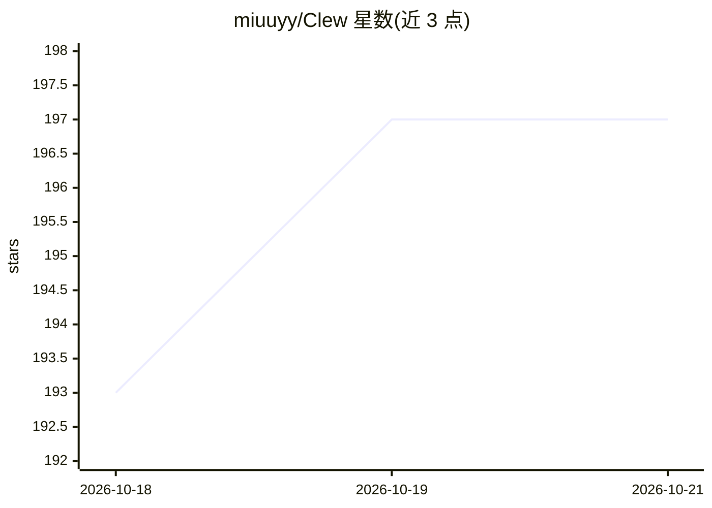

# miuuyy/Clew

⭐ 198 · TypeScript · MIT · 推送 2026-10-22 · [GitHub](https://github.com/miuuyy/Clew) · [官网](https://clew.my) · 个人维护

**把学习目标与笔记转为依赖关系学习图谱的桌面应用**

基于 Electron 的本地学习图谱应用：将目标、教学大纲或 Obsidian 笔记文件夹生成为主题与先修关系的图谱，点击主题可查看其依赖路径。内置助手可讲解、出题测验、扩展图谱，模型提出的修改以提案形式供用户审核应用，可回滚快照。AI 能力通过 ChatGPT Plus/Pro 计划接入，无需 API key；图谱与凭证分别存储在本地 SQLite 与系统凭证库。提供 Windows/macOS/Linux 安装包，另含只读 MCP 服务器与 Markdown/图谱导出。

## 筛选速览

| 维度 | 判定 | 备注 |
|---|---|---|
| AI 角色 | `ai-native` | 本体是模型或模型工具 |
| 许可风险 | `permissive` | MIT |
| 部署形态 | `None` |  |
| 模型依赖 | — | README 未给出锁定关系 |
| 硬件要求 | — | 无带数字的原话,不猜 |
| 安装摩擦 | `low` | 无编译、无系统依赖或容器化 |
| 成熟度 | — | 结构信号不足 |

## 能力要点

- 目标/大纲/Obsidian 笔记转主题先修图谱
- AI 提案制修改：模型提议、应用校验、快照可回滚
- 经 ChatGPT Plus/Pro 计划认证接入，无需 API key
- 提供只读 MCP 服务器与 Markdown/图谱导出

## 适用场景

- 把想学的目标拆解成带依赖路径的学习路线图
- 导入 Obsidian 笔记整理知识结构并跟踪进度
- 让助手讲解、出题并按需扩展图谱

## 场景标签

`知识库管理` · 领域:知识与检索

## 证据(README 行号)

> L5: **A learning graph, powered by your ChatGPT plan.**
> L7: Clew turns a goal, syllabus, or folder of notes into a map of topics and prerequisites. Click a topic to see the pat
> L21: Open Clew and select **Continue with ChatGPT**. A ChatGPT **Plus or Pro** plan and permission to use that plan are 

## 星数曲线

2026-10-18 193 → 2026-10-21 197（+4）

---
*卡片 v1 · prompt 1.4 · 生成 2026-10-22 · 置信度 high · 依据 README sha `b9b31307855b` · [字段定义](../../DATASET.md)*
