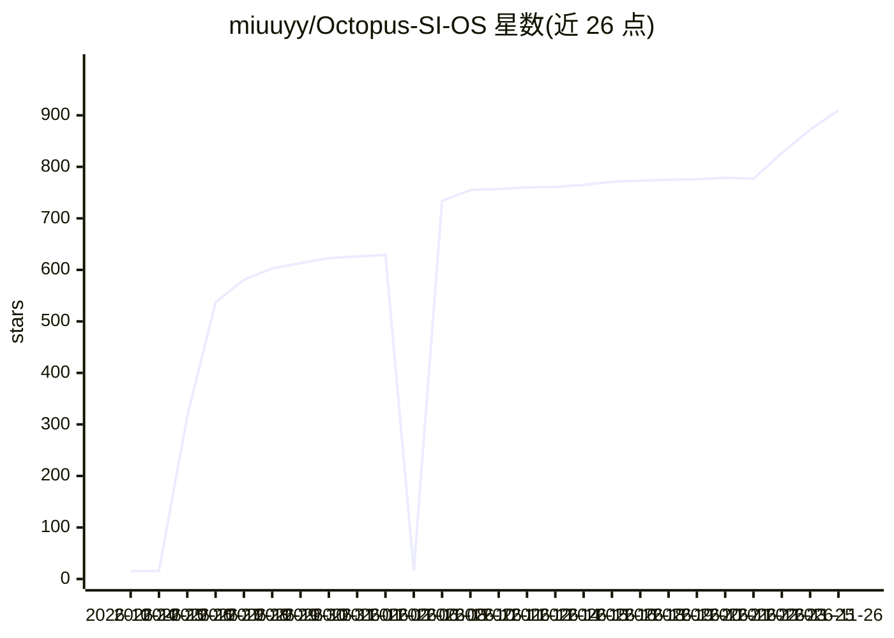

# miuuyy/Octopus-SI-OS

⭐ 910 · Rust · MIT · 推送 2026-11-25 · [GitHub](https://github.com/miuuyy/Octopus-SI-OS) · [官网](octopus-os.si) · 个人维护 · 中文 README

**面向长时段自治 agent 工作的实验性自进化操作系统**

Octopus 是一个基于操作系统原则的持久 agent 工作运行时：目标、权限、运行、工具、上下文与外部事件以持久记录而非模型循环内状态的形式存在，Rust 内核负责形成授权、裁决工件移动并写入 append-only 账本。代理可在策略下自建目标、增删工具、组织 worker 并持久化这些改动，实现跨任务的自我调整。提供 macOS 桌面客户端与终端客户端，模型通过注册接口接入，运行时保持 provider 无关。README 标注为研究预览，格式可能在版本间变动。

## 筛选速览

| 维度 | 判定 | 备注 |
|---|---|---|
| AI 角色 | `ai-ecosystem` | LLM/agent 周边工具 |
| 许可风险 | `permissive` | MIT |
| 部署形态 | `None` |  |
| 模型依赖 | — | README 未给出锁定关系 |
| 硬件要求 | — | 无带数字的原话,不猜 |
| 安装摩擦 | `low` | 无编译、无系统依赖或容器化 |
| 成熟度 | `idea` | |

## 能力要点

- Rust 内核 + append-only 移动账本，授权在模型外部重算与强制执行
- 自进化机制：agent 可创建目标、添加接口与工具并跨运行持久化
- 声明式扩展：provider、channel、worker、tool 均以 JSON 文件夹形式接入
- 可选 macOS 14+ 桌面客户端（语音、任务）与共享状态的终端客户端

## 适用场景

- 让 agent 跨小时/天级持续组织目标与运行，而非一次性对话
- 以文件级授权与沙箱约束 agent 对文件、浏览器、桌面的访问
- 通过 MCP 服务器、聊天通道与其他 provider 扩展 agent 的外部世界

## 场景标签

`Agent 框架` · 领域:Agent 开发

## 证据(README 行号)

> L18: Octopus is an operating system for persistent agent work. Goals, permissions,
> L49: > Active experiments focus there while the runtime stays provider-agnostic, with

## 星数曲线

2026-10-24 15 → 2026-11-26 910（+895）

---
*卡片 v1 · prompt 1.4 · 生成 2026-11-26 · 置信度 high · 依据 README sha `200b5cc811ff` · [字段定义](../../DATASET.md)*
