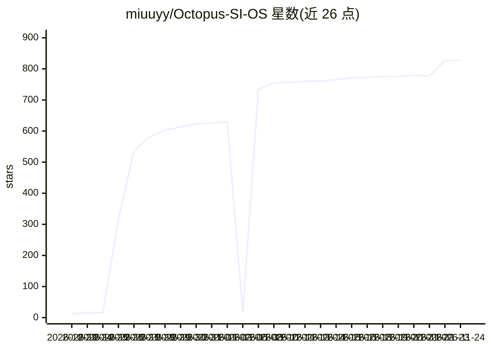

# miuuyy/Octopus-SI-OS

⭐ 827 · Rust · MIT · 推送 2026-11-22 · [GitHub](https://github.com/miuuyy/Octopus-SI-OS) · 个人维护

**面向 agent 持久工作的自演进操作系统（研究预览）**

基于操作系统原则的 agent 执行架构：目标、权限、运行、工具、上下文与外部事件以持久记录而非模型内状态存在；小型 Rust 内核生成授权、裁决 artifact 跨界移动并写入 append-only 账本。macOS 客户端提供 Home、Projects、Agents、Tasks 界面，支持文本与语音交互；首个移植的 provider 为 Codex CLI，也可配置 API-key、OpenAI 兼容、Claude CLI、Gemini 或 Vertex。含终端客户端与两个独立示例工具。声明为研究预览，非 AGI 或自主自我改进的证明。

## 筛选速览

| 维度 | 判定 | 备注 |
|---|---|---|
| AI 角色 | `ai-ecosystem` | LLM/agent 周边工具 |
| 许可风险 | `permissive` | MIT |
| 部署形态 | `None` |  |
| 模型依赖 | — | README 未给出锁定关系 |
| 硬件要求 | — | 无带数字的原话,不猜 |
| 安装摩擦 | `low` | 无编译、无系统依赖或容器化 |
| 成熟度 | `idea` | |

## 能力要点

- Rust 内核以 grant 与 append-only ledger 在模型外执行权限与记录
- agent 可在策略内创建目标、新增工具、组织 worker，变更跨任务持久
- worker 为两个 JSON 文件的非程序描述，可按需扩展运行
- 提供 macOS 桌面客户端与共享状态的终端客户端

## 适用场景

- 让 agent 在权限受控的沙箱环境中执行长时任务
- 以文件与 JSON 文件夹方式扩展 provider、通道、工具
- 在 macOS 上以文本或语音与多项目 agent 系统交互

## 场景标签

`Agent 框架` · 领域:Agent 开发

## 证据(README 行号)

> L16: Octopus is an operating system for persistent agent work. Goals, permissions,
> L24: applications, and connected services. Codex CLI is the first provider ported
> L135: The kernel never pushes anything and never decodes a payload. Each interface is a live process reading its own mov

## 星数曲线

2026-10-22 13 → 2026-11-24 827（+814）

---
*卡片 v1 · prompt 1.4 · 生成 2026-11-24 · 置信度 high · 依据 README sha `ef7cec998965` · [字段定义](../../DATASET.md)*
