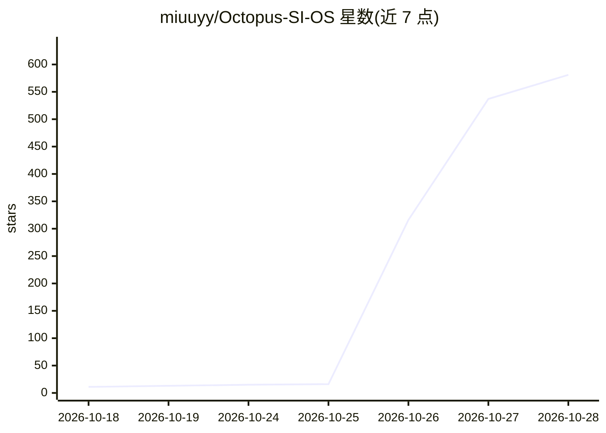

# miuuyy/Octopus-SI-OS

⭐ 603 · Rust · MIT · 推送 2026-10-28 · [GitHub](https://github.com/miuuyy/Octopus-SI-OS) · 个人维护

**自进化 agentic OS：以操作系统原理运行 AI agent 的研究预览**

用 Rust 编写的 agentic 操作系统内核（约 4.5 万行），以接口、工件、Run、执行环境、Worker、策略等原语组织 agent 执行，无中心编排器。agent 可在策略约束下创建目标、添加工具、注册新接口以改变自身环境。首个接入的模型界面为 Codex（用 ChatGPT 账号登录），提供 macOS 桌面客户端与终端客户端。需 macOS 14+、Node 24、stable Rust，从源码克隆并自行打包，构建产物为 ad-hoc 签名、未经 notarization。README 自述为研究预览，普通编码任务相比 Codex CLI 无额外收益。

## 筛选速览

| 维度 | 判定 | 备注 |
|---|---|---|
| AI 角色 | `ai-ecosystem` | LLM/agent 周边工具 |
| 许可风险 | `permissive` | MIT |
| 部署形态 | `None` |  |
| 模型依赖 | — | README 未给出锁定关系 |
| 硬件要求 | — | 无带数字的原话,不猜 |
| 安装摩擦 | `low` | 无编译、无系统依赖或容器化 |
| 成熟度 | `idea` | |

## 能力要点

- Rust 内核 + 接口/工件/Run/策略等原语的无编排器架构
- agent 可在策略下创建工具、注册接口以扩展自身能力
- 桌面客户端与终端客户端共享同一 Home/Projects/Agents
- 工具运行于 deny-by-default 沙箱，所有动作记录于 ledger

## 适用场景

- 研究 agent 重塑执行环境的架构与自主性
- 在 macOS 上以桌面/终端客户端运行多 agent 任务
- 通过接口文件夹扩展 provider、传感器与工具

## 场景标签

`Agent 框架` `多智能体` · 领域:Agent 开发

## 证据(README 行号)

> L6:  A new architecture for agent execution, built on operating-system principles, where agents can reshape their enviro
> L17: Underneath, its architecture gives an agent a structure to execute in and a picture of itself and of the world. Cap
> L22: > This is a research preview. In our runs so far, today's models - GPT-6 included - do not take initiative on their

## 星数曲线

2026-10-18 11 → 2026-10-28 581（+570）

---
*卡片 v1 · prompt 1.4 · 生成 2026-10-25 · 置信度 high · 依据 README sha `e9f828b4c2e5` · [字段定义](../../DATASET.md)*
