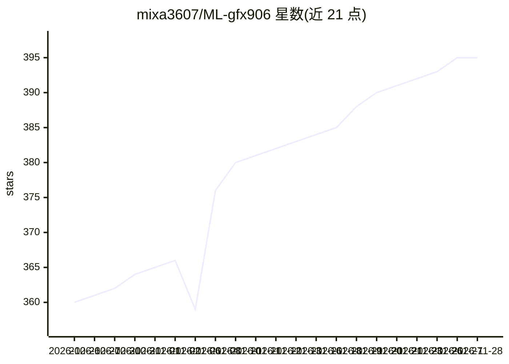

# mixa3607/ML-gfx906

⭐ 395 · C++ · MIT · 推送 2026-11-23 · [GitHub](https://github.com/mixa3607/ML-gfx906) · [官网](https://arkprojects.space/wiki/AMD_GFX906) · 个人维护

**为 AMD gfx906 GPU（Radeon VII/MI50/MI60）提供预编译 ML 软件**

面向 AMD gfx906 架构 GPU 的机器学习软件构建仓库：通过 APT 仓库和容器镜像分发 llama.cpp、ComfyUI、vLLM、PyTorch、Maya 及 ROCm 相关工具（ROCm Toolkit、Validation Suite、TransferBench、AMD Memory Tweak 等）的预构建产物，省去用户自行编译。安装方式为在 Ubuntu 24.04 添加 APT 仓库。文档站为 arkprojects.space wiki。旧版 legacy 构建自 20260802001858 版本起不再支持，vLLM 与 ROCm Bandwidth Test 处于暂停状态，ROCm tensile 已标记弃用。

## 筛选速览

| 维度 | 判定 | 备注 |
|---|---|---|
| AI 角色 | `ai-ecosystem` | LLM/agent 周边工具 |
| 许可风险 | `permissive` | MIT |
| 部署形态 | `None` |  |
| 模型依赖 | — | README 未给出锁定关系 |
| 硬件要求 | — | 无带数字的原话,不猜 |
| 安装摩擦 | `medium` | 含编译或系统依赖之一 |
| 成熟度 | — | 结构信号不足 |

## 能力要点

- 为 gfx906 GPU 提供 llama.cpp、ComfyUI、PyTorch 等预构建镜像与包
- 通过 APT 仓库分发 deb 包，支持 Ubuntu 24.04
- 包含 ROCm 生态工具：Toolkit、Validation Suite、TransferBench、内存/调频工具
- 子项目状态表标注构建状态（Ok/Paused/Deprecated）

## 适用场景

- 在 Radeon VII / MI50 / MI60 上直接运行 llama.cpp 与 ComfyUI 而无需自行编译
- 安装 ROCm 相关调试与验证工具
- 部署 MI50/Vega 20 的 Prometheus 遥测导出器

## 场景标签

 · 领域:AI 基础设施/硬件适配构建

## 证据(README 行号)

> L1: # ML software for deprecated GFX906 arch
> L35: |llama.cpp|llama.cpp|image|GitHub Actions Workflow Status|readme|
> L37: |ComfyUI|ComfyUI|image|GitHub Actions Workflow Status|readme|

## 星数曲线

2026-10-26 360 → 2026-11-28 395（+35）

---
*卡片 v1 · prompt 1.4 · 生成 2026-11-25 · 置信度 high · 依据 README sha `8a4f229010c4` · [字段定义](../../DATASET.md)*
