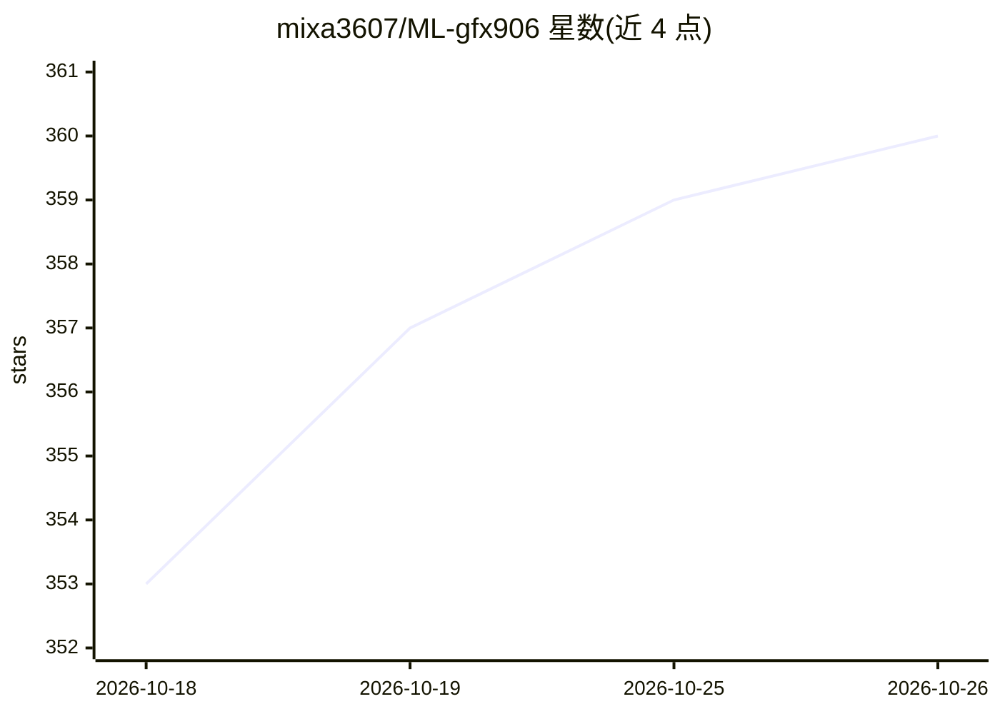

# mixa3607/ML-gfx906

⭐ 360 · C++ · MIT · 推送 2026-10-23 · [GitHub](https://github.com/mixa3607/ML-gfx906) · [官网](https://arkprojects.space/wiki/AMD_GFX906) · 个人维护

**面向 AMD gfx906（Radeon VII/MI50/MI60）的 ML 软件构建仓库**

为已停止官方支持的 AMD gfx906 架构 GPU 提供 ROCm、PyTorch、llama.cpp、ComfyUI、vLLM 等 ML 软件的 deb 包与容器镜像构建，通过 Ubuntu 24.04 的 apt 仓库分发；另含显存时序调整、GPU 调优、Prometheus 监控导出等运维工具。自 20260802001858 版起新构建迁移到 TheRock，旧版构建不再支持。vLLM 与 ROCm tensile 子项目分别处于 Paused 与 Deprecated 状态。

## 筛选速览

| 维度 | 判定 | 备注 |
|---|---|---|
| AI 角色 | `ai-ecosystem` | LLM/agent 周边工具 |
| 许可风险 | `permissive` | MIT |
| 部署形态 | `None` |  |
| 模型依赖 | local-ok | 支持本地模型 |
| 硬件要求 | — | 无带数字的原话,不猜 |
| 安装摩擦 | `medium` | 含编译或系统依赖之一 |
| 成熟度 | — | 结构信号不足 |

## 能力要点

- 覆盖 ROCm/PyTorch/llama.cpp/ComfyUI/vLLM 的 gfx906 构建产物（deb 与容器镜像）
- Ubuntu 24.04 apt 仓库方式分发安装
- 附带 AMD Memory Tweak、GPU Tuning、Vega20 Prometheus 监控导出等运维工具
- llama.cpp multiruntime 镜像含 CPU/RPC/ROCm/CUDA 多后端

## 适用场景

- 在 Radeon VII / MI50 / MI60 等 gfx906 显卡上继续运行 LLM 推理与 ComfyUI 工作流
- 为旧 AMD 架构获取 ROCm 与 PyTorch 的可用构建
- 监控与调优 MI50/Vega 20 显卡节点

## 场景标签

`推理引擎` · 领域:训练与推理

## 证据(README 行号)

> L1: # ML software for deprecated GFX906 arch
> L35: |llama.cpp|llama.cpp|image|GitHub Actions Workflow Status|readme|
> L39: |vLLM|vLLM|image|Paused|readme|

## 星数曲线

2026-10-18 353 → 2026-10-26 360（+7）

---
*卡片 v1 · prompt 1.4 · 生成 2026-10-21 · 置信度 high · 依据 README sha `8cca3d09b41b` · [字段定义](../../DATASET.md)*
