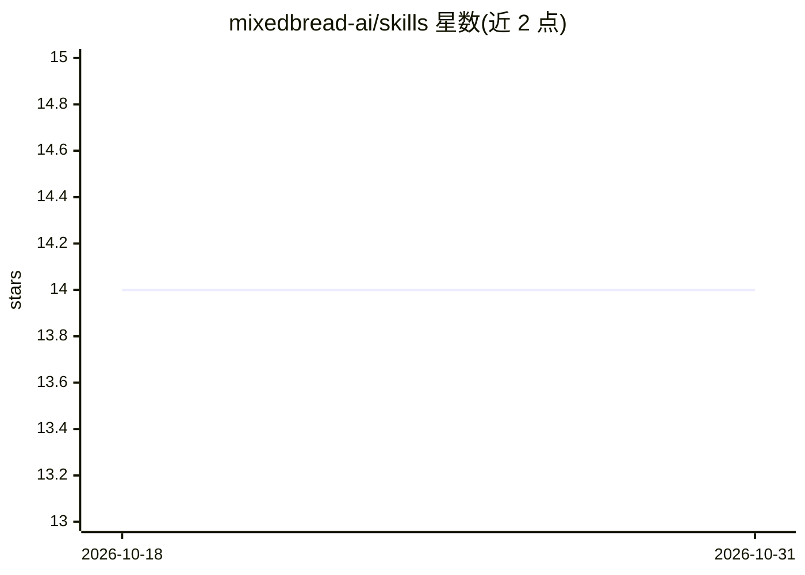

# mixedbread-ai/skills

⭐ 14 · Python · Apache-2.0 · 推送 2026-09-16 · [GitHub](https://github.com/mixedbread-ai/skills) · [官网](https://www.mixedbread.com/docs/skills) · 组织维护

**Mixedbread 官方 agent 技能包：搜索、RAG、文档解析五项技能**

由 Mixedbread 维护的 agent skills 集合，含五个技能：mxbai-cli（通过 mxbai CLI 管理存储、上传文件与搜索）、mixedbread-search（用 Stores API 构建和检索知识库）、mixedbread-parsing（文档解析、结构化抽取与 OCR）、mixedbread-search-agent 与 harness（调用 Toast-1 搜索模型与设计后端 harness）。兼容 Claude Code、Cursor、Codex、Gemini CLI 等 20+ agent，经 npx skills 安装或从 Cursor marketplace 安装。

## 筛选速览

| 维度 | 判定 | 备注 |
|---|---|---|
| AI 角色 | `ai-ecosystem` | LLM/agent 周边工具 |
| 许可风险 | `permissive` | Apache-2.0 |
| 部署形态 | `library` | 以包/库形式分发 |
| 模型依赖 | — | README 未给出锁定关系 |
| 硬件要求 | — | 无带数字的原话,不猜 |
| 安装摩擦 | `low` | 无编译、无系统依赖或容器化 |
| 成熟度 | — | 结构信号不足 |

## 能力要点

- 五个技能覆盖 CLI 管理、知识库搜索、文档解析/OCR、Toast-1 搜索 agent 与 harness 设计
- 兼容 Claude Code、Cursor、Codex、Gemini CLI 及 20+ 其他 agent
- npx skills 一条命令安装全部技能，安装为快照并可检查更新

## 适用场景

- 给 Claude Code/Cursor 等 agent 添加 Mixedbread 搜索与解析能力
- 构建和管理基于 Stores API 的知识库
- 设计 Toast-1 搜索 agent 的后端 harness

## 场景标签

`文档解析` `RAG` `语义搜索` · 领域:知识与检索

## 证据(README 行号)

> L7: Agent skills for building search, RAG, document parsing, search-grounded completions, and agent harnesses with Mixed
> L70: |`mxbai-cli`|Manage stores, upload files, search, and sync using the `mxbai` CLI|
> L73: |`mixedbread-search-agent`|Call Mixedbread's Toast-1 search model through the Chat Completions and Responses APIs: 

## 星数曲线

2026-10-18 14 → 2026-10-31 14（+0）

---
*卡片 v1 · prompt 1.4 · 生成 2026-10-31 · 置信度 high · 依据 README sha `07bddaaa3584` · [字段定义](../../DATASET.md)*
