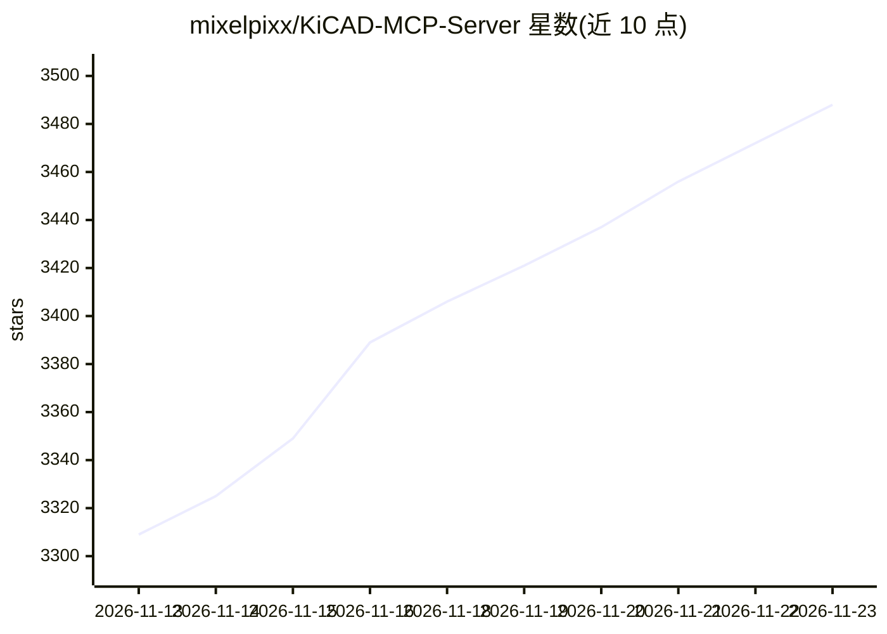

# mixelpixx/KiCAD-MCP-Server

⭐ 3,488 · Python · MIT · 推送 2026-11-22 · [GitHub](https://github.com/mixelpixx/KiCAD-MCP-Server) · [官网](https://kicad.orchis.ai) · 个人维护 · 中文 README

**让 Claude 等 AI 助手直接操作 KiCAD 做 PCB 设计的 MCP 服务器**

基于 MCP 2025-06-18 规范的 Python+TypeScript 服务器，使 LLM 客户端（Claude Desktop、Claude Code、VS Code GitHub Copilot 等）接入 KiCAD 9/10，实现原理图编辑、元件放置、布线、DRC/ERC 检查、自定义符号/封装生成、JLCPCB 元件目录查询与 Freerouting 自动布线（Java/Docker）。安装需先装 KiCAD 9.0+、Node.js 18+ 与 Python 3.11+，再 clone 源码构建。通过 KiCad Python API（SWIG）工作，IPC 后端为实验性。README 明确声明 AI 生成设计不替代工程审查。

## 筛选速览

| 维度 | 判定 | 备注 |
|---|---|---|
| AI 角色 | `ai-ecosystem` | LLM/agent 周边工具 |
| 许可风险 | `permissive` | MIT |
| 部署形态 | `library` | 以包/库形式分发 |
| 模型依赖 | locked-api |  |
| 硬件要求 | — | 无带数字的原话,不猜 |
| 安装摩擦 | `low` | 无编译、无系统依赖或容器化 |
| 成熟度 | — | 结构信号不足 |

## 能力要点

- 原理图编辑、布线、DRC/ERC、生产文件导出的工具集
- 自定义符号与封装生成，覆盖标准库外模块
- JLCPCB 元件目录（价格/库存）与 Freerouting 自动布线集成
- 跨 Windows/Linux/macOS，支持 Claude Desktop 与 VS Code Copilot 客户端

## 适用场景

- 用自然语言让 AI 助手搭建和修改 KiCAD PCB 工程
- 自动生成非标准模块的符号与封装
- 布线后自动跑 DRC/ERC 并导出生产文件

## 场景标签

 · 领域:EDA/硬件设计工具

## 证据(README 行号)

> L63: **KiCAD MCP Server** is a Model Context Protocol (MCP) server that enables AI assistants like Claude to interact wi
> L15: **Open source (MIT) and actively maintained.** New releases keep coming, and bug reports, pull

## 星数曲线

2026-11-13 3,309 → 2026-11-23 3,488（+179）

---
*卡片 v1 · prompt 1.4 · 生成 2026-11-17 · 置信度 high · 依据 README sha `de0912d0e9e4` · [字段定义](../../DATASET.md)*
