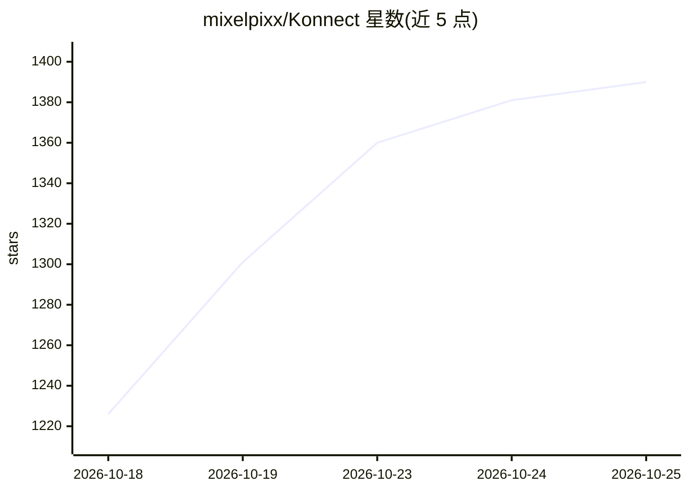

# mixelpixx/Konnect

⭐ 1,407 · Rust · AGPL-3.0 · 推送 2026-10-25 · [GitHub](https://github.com/mixelpixx/Konnect) · 个人维护

**让 Claude 等 AI 通过 MCP 直接设计 KiCAD 原理图与 PCB 的插件**

Konnect 是一个原生 KiCAD 10 插件，以单个 Rust 静态二进制（约 20-25 MB）通过 MCP 协议向 Claude、Codex 等 AI 客户端暴露 228 个工具、21 个按需加载的工具集，覆盖原理图绘制、PCB 布局布线、ERC/DRC 检查、JLCPCB 元件搜索、参考电路与生产文件导出。原理图通过自带 S 表达式引擎原子写入，PCB 走 KiCad 10 IPC API，路由经 Specctra DSN/SES 流程配合 Freerouting。自述为 beta 版本，通过 KiCAD Plugin Manager 安装或 cargo 从源码构建。

## 筛选速览

| 维度 | 判定 | 备注 |
|---|---|---|
| AI 角色 | `ai-ecosystem` | LLM/agent 周边工具 |
| 许可风险 | `dual` | AGPL-3.0 |
| 部署形态 | `desktop` | 安装包/桌面程序 |
| 模型依赖 | locked-api |  |
| 硬件要求 | — | 无带数字的原话,不猜 |
| 安装摩擦 | `medium` | 含编译或系统依赖之一 |
| 成熟度 | `idea` | |

## 能力要点

- 单个 Rust 静态二进制提供 228 个工具、21 个按需工具集
- 原理图 S 表达式原子写入；PCB 经 KiCad 10 IPC API 实时编辑并集成撤销/重做
- 内置 2.5M 元件的 JLCPCB 元件搜索与参考电路模板
- 捆绑面向 Claude 与 Codex 的 KiCad 技能/代理指导文件

## 适用场景

- 让 Claude 等 AI 客户端直接完成原理图绘制与 PCB 布局布线
- 在 AI 辅助流程中运行 ERC/DRC 与设计审查并导出生产文件
- 通过 MCP 客户端（Claude Desktop、Claude Code、Codex）集成到硬件设计工作流

## 场景标签

 · 领域:EDA/硬件设计工具

## 证据(README 行号)

> L5: **AI-assisted PCB design for KiCAD 10.** Konnect is a native KiCAD plugin — a single
> L6: Rust binary — that lets Claude and other AI assistants design schematics and PCBs
> L7: through the Model Context Protocol (MCP).

## 星数曲线

2026-10-18 1,226 → 2026-10-25 1,390（+164）

---
*卡片 v1 · prompt 1.4 · 生成 2026-10-21 · 置信度 high · 依据 README sha `ab529ba90e39` · [字段定义](../../DATASET.md)*
