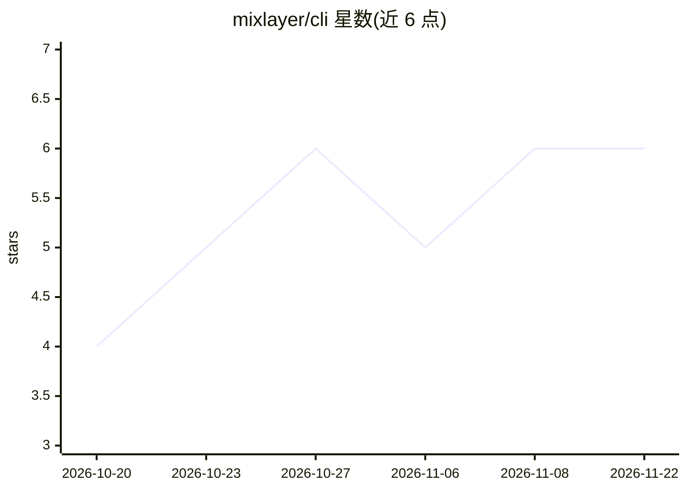

# mixlayer/cli

⭐ 6 · Rust · Apache-2.0 · 推送 2026-11-04 · [GitHub](https://github.com/mixlayer/cli) · [官网](https://mixlayer.com) · 组织维护

**从终端与编码 agent 运行开源模型的官方 CLI**

Mixlayer 官方命令行工具（Rust 编写，macOS/Linux/Windows 预编译包），支持在终端调用 DeepSeek、Qwen、GLM 等开源模型并显示每次回答的成本。机制包括：escalate/compare/savings 的按成本分级与比价、ladder/council 多模型横向对比、本地 SQLite 账本记录每次调用、shield 对 prompt 做个人数据掩码后发送、models sync 把模型接入 Codex/OpenCode/Hermes 等 agent、agent setup 安装 Agent Skill 与 MCP server。需要 Mixlayer API key。

## 筛选速览

| 维度 | 判定 | 备注 |
|---|---|---|
| AI 角色 | `ai-ecosystem` | LLM/agent 周边工具 |
| 许可风险 | `permissive` | Apache-2.0 |
| 部署形态 | `library` | 以包/库形式分发 |
| 模型依赖 | local-ok | 支持本地模型 |
| 硬件要求 | — | 无带数字的原话,不猜 |
| 安装摩擦 | `medium` | 含编译或系统依赖之一 |
| 成熟度 | — | 结构信号不足 |

## 能力要点

- escalate/compare/savings：按任务在便宜与前沿模型间分级调用并核算节省
- ladder/council：同一 prompt 跑多模型，显示延迟、token 与成本，judge 模型汇总分歧
- shield 本地 PII 掩码（regex 或本地 Ollama 模型做检测），支持任意上游 provider
- models sync/agent setup：把模型与 MCP server 接入 Claude Code、Codex、Cursor 等 agent

## 适用场景

- 在终端直接向开源模型提问并看到每次调用的费用
- 为编码 agent 配置 Mixlayer 模型接入与 MCP server
- 发送含客户数据的内容前先做本地 PII 掩码
- 脚本/CI 中用 JSON 输出与退出码控制调用流程

## 场景标签

`模型网关` · 领域:Agent 开发

## 证据(README 行号)

> L8: The official command-line tool for Mixlayer. Run open models like DeepSeek, Qwen and GLM from your terminal, see wha
> L36: **Run your coding agent on Mixlayer models.** `models sync` adds Mixlayer's current models to Codex, OpenCode and H
> L56: `mxl agent setup` installs an Agent Skill and an MCP server into Claude Code, Codex, Cursor, Hermes or Claude Deskt

## 星数曲线

2026-10-20 4 → 2026-11-22 6（+2）

---
*卡片 v1 · prompt 1.4 · 生成 2026-11-20 · 置信度 mid · 依据 README sha `232865164a15` · [字段定义](../../DATASET.md)*
