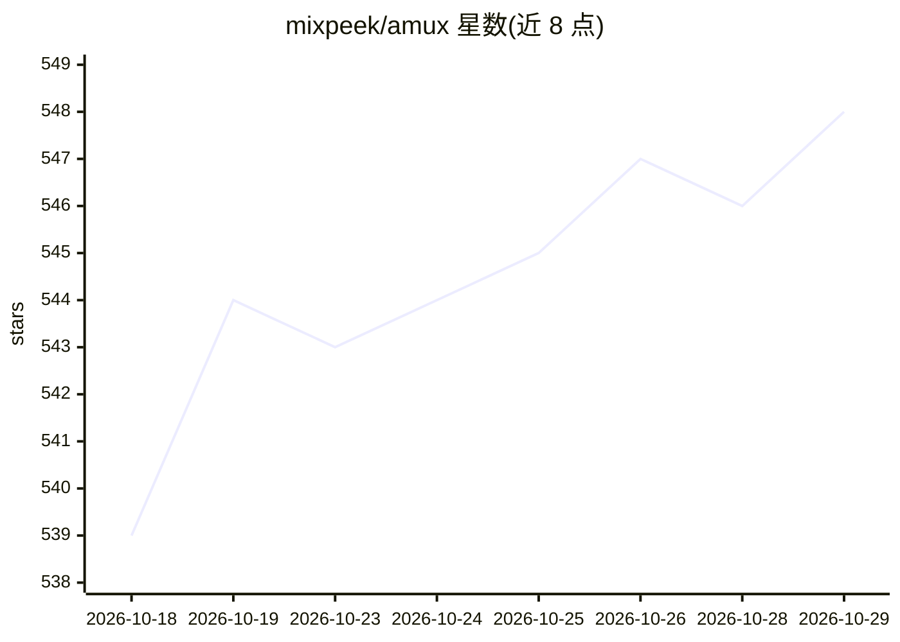

# mixpeek/amux

⭐ 548 · Rust · NOASSERTION · 推送 2026-10-28 · [GitHub](https://github.com/mixpeek/amux) · [官网](https://amux.io) · 组织维护

**并行编排 Claude Code/Codex/Gemini 等 AI 编码 agent 的控制平面**

用 Rust 实现的单二进制控制平面，在 macOS/Linux 上通过 tmux 并行运行 Claude Code、Codex、Gemini CLI、OpenCode 或 Ollama 等 agent CLI，每个 worker 可切换模型。提供共享任务板（原子认领防冲突）、agent 间消息、崩溃后自愈恢复、定时任务与循环调度。访问方式为本地网页面板、iPhone/iPad 应用、Mac 原生应用或浏览器；另有付费的 amux Cloud 托管服务器。依赖 tmux 3.2+ 与至少一个 agent CLI。Mac 应用尚未公证。

## 筛选速览

| 维度 | 判定 | 备注 |
|---|---|---|
| AI 角色 | `ai-ecosystem` | LLM/agent 周边工具 |
| 许可风险 | `none` | NOASSERTION |
| 部署形态 | `desktop` | 安装包/桌面程序 |
| 模型依赖 | local-ok | 支持本地模型 |
| 硬件要求 | — | 无带数字的原话,不猜 |
| 安装摩擦 | `low` | 无编译、无系统依赖或容器化 |
| 成熟度 | — | 结构信号不足 |

## 能力要点

- 单 Rust 二进制 + SQLite，本地优先运行
- 共享任务板与原子认领，agent 间消息互通
- 会话崩溃自愈恢复，支持定时与循环调度
- Mac/iPhone/iPad/浏览器多端操控，worker 级模型切换

## 适用场景

- 让多个 AI 编码 agent 并行处理任务并在手机上监督
- 夜间定时运行 agent 任务，崩溃后自动恢复
- 为多个 agent 分配共享任务板避免重复工作

## 场景标签

`多智能体` `编码 Agent` · 领域:Agent 开发

## 证据(README 行号)

> L7: **Run an AI engineering team.** amux runs Claude Code, Codex and Gemini CLI agents in parallel from one dashboard or
> L62: - **Any model.** Claude Code, Codex, Gemini CLI, OpenCode or Ollama, switchable per worker.
> L64: Local-first: one Rust binary and SQLite on your own machine.

## 星数曲线

2026-10-18 539 → 2026-10-29 548（+9）

---
*卡片 v1 · prompt 1.4 · 生成 2026-10-22 · 置信度 high · 依据 README sha `9be9a22e4949` · [字段定义](../../DATASET.md)*
