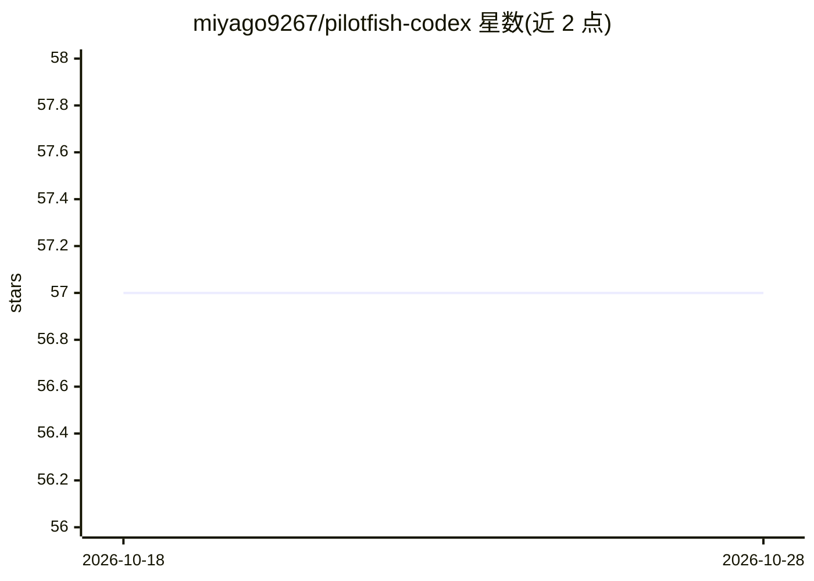

# miyago9267/pilotfish-codex

⭐ 57 · Python · MIT · 推送 2026-09-30 · [GitHub](https://github.com/miyago9267/pilotfish-codex) · 个人维护 · 中文 README

**Codex CLI 的多模型编排层：按意图路由请求并分配受界角色**

改编自 Pilotfish 的 Codex CLI 适配，提供自适应意图路由（execute / explore_then_plan / co_discover 三种首步模式）、八个受界角色（scout、executor、verifier 等）、显式审批边界与新鲜上下文结果核验；按模型分层（Luna 做机械工作、Sol 做常规判断、Astra 仅在深边界）由根会话做路由决策，不自动切换模型。通过 Bash/PowerShell 安装脚本部署到 Codex home。仓库已迁移至 miyago9267/shoal，v1.8.1 是此处最后发布版本，新安装建议改用 shoal。

## 筛选速览

| 维度 | 判定 | 备注 |
|---|---|---|
| AI 角色 | `ai-ecosystem` | LLM/agent 周边工具 |
| 许可风险 | `permissive` | MIT |
| 部署形态 | `None` |  |
| 模型依赖 | — | README 未给出锁定关系 |
| 硬件要求 | — | 无带数字的原话,不猜 |
| 安装摩擦 | `low` | 无编译、无系统依赖或容器化 |
| 成熟度 | `idea` | |

## 能力要点

- 三种意图路由模式决定首步交互形态
- 八个受界角色 + 显式审批边界 + 新鲜上下文核验
- Luna/Sol/Astra 分层路由，根会话不自动切换模型
- 60 用例实测：模式路由与审批边界 60/60，完整路由契约 48/60

## 适用场景

- 为 Codex CLI 增加意图路由与角色化多代理编排
- 对安全敏感任务使用 security-reviewer/security-executor 分离能力边界
- 按变更规模与风险控制审批与验证流程

## 场景标签

`编码 Agent` `多智能体` · 领域:Agent 开发

## 证据(README 行号)

> L21: Pilotfish-Codex is an independent Codex CLI adaptation inspired by
> L23: roles, explicit approval boundaries, adaptive intent routing, and
> L199: The installer adds the native Pilotfish role manifest and routing hook,

## 星数曲线

2026-10-18 57 → 2026-10-28 57（+0）

---
*卡片 v1 · prompt 1.4 · 生成 2026-10-24 · 置信度 high · 依据 README sha `dae99049efba` · [字段定义](../../DATASET.md)*
