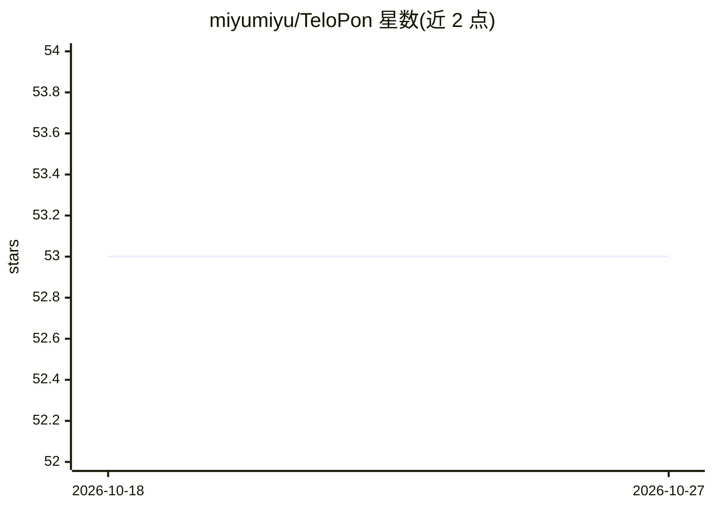

# miyumiyu/TeloPon

⭐ 53 · 推送 2026-05-06 · [GitHub](https://github.com/miyumiyu/TeloPon) · [官网](https://x.com/miyumiyuna5) · 个人维护 · 中文 README

**给直播主的语音 AI 助手：实时字幕、互动与直播操控**

面向直播主的 Windows 桌面应用：通过 Gemini Live API 直接处理主播语音，在 OBS 浏览器源中实时显示字幕（テロップ），并可语音操控直播相关操作——OBS 录制、YouTube/Twitch/ニコニコ的问卷/标题/剪辑、X(Twitter) 发推、PowerPoint 翻页等。支持以文本文件提示词自定义 AI 角色性格、CSS 自定义字幕外观、插件扩展（内置 9 个，可下载更多）。需要 Google 账号与 Gemini API Key，从 Releases 下载 ZIP 解压运行 exe。README 自述为早期访问版，无保证且禁止逆向与再分发。

## 筛选速览

| 维度 | 判定 | 备注 |
|---|---|---|
| AI 角色 | `ai-native` | 本体是模型或模型工具 |
| 许可风险 | `none` | — |
| 部署形态 | `desktop` | 安装包/桌面程序 |
| 模型依赖 | — | README 未给出锁定关系 |
| 硬件要求 | — | 无带数字的原话,不猜 |
| 安装摩擦 | `low` | 无编译、无系统依赖或容器化 |
| 成熟度 | `idea` | |

## 能力要点

- Gemini Live API 处理语音，声称低延迟实时字幕
- 语音操控 OBS 录制、YouTube/Twitch/ニコニコ 操作、X 发推、PowerPoint 演示
- 提示词文件自定义 AI 角色性格，CSS 自定义字幕样式
- 插件体系：9 个内置插件，支持一键下载扩展插件与自制 .py 插件

## 适用场景

- 直播时自动把我说话的内容实时转成字幕显示在 OBS
- 用语音指令操作录制、投票、改标题、发推等直播工作
- 让 AI 读取观众评论并基于游戏画面做实时解说

## 场景标签

`语音识别` `GUI 自动化` · 领域:效率与自动化

## 证据(README 行号)

> L5: **AIが配信者の声を聞いて、リアルタイムにテロップ・実況・配信支援を行う次世代AIアシスタント**
> L13: 配信者の声をGemini Live APIで直接処理。音声認識→テキスト化→AI送信のステップを排除し、**会話のテンポを崩さない超低遅延レスポンス**を実現。

## 星数曲线

2026-10-18 53 → 2026-10-27 53（+0）

---
*卡片 v1 · prompt 1.4 · 生成 2026-10-24 · 置信度 high · 依据 README sha `13e3974e7062` · [字段定义](../../DATASET.md)*
