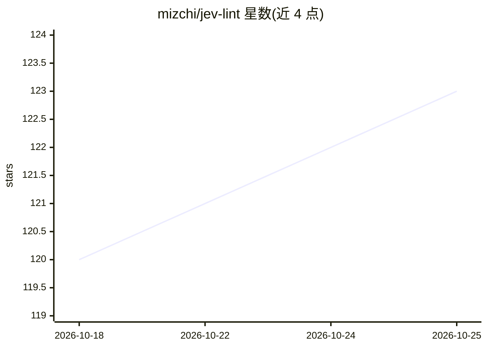

# mizchi/jev-lint

⭐ 123 · TypeScript · MIT · 推送 2026-10-02 · [GitHub](https://github.com/mizchi/jev-lint) · 个人维护

**用 Jev 模型校验代码自我声明一致性的 Lint 工具**

面向开发者的代码 lint 工具：ast-grep 匹配器选定代码，将代码发送到 API，由 Jev 分类模型回答一句自然语言问题并输出校准概率，超过阈值的判定为 finding。规则即一句话，内置 99 条规则，覆盖命名与实现、注释与代码、测试与声称、shell 脚本行为、commit message 与 diff 等矛盾类问题。支持 diff 范围 review、CI 与 git hook、缓存与 replay。判读非确定性：约五分之一 finding 有误，结果按候选供人工判断。API key 通过环境变量读取，需 Node 24+，npx 即可运行。

## 筛选速览

| 维度 | 判定 | 备注 |
|---|---|---|
| AI 角色 | `ai-native` | 本体是模型或模型工具 |
| 许可风险 | `permissive` | MIT |
| 部署形态 | `library` | 以包/库形式分发 |
| 模型依赖 | — | README 未给出锁定关系 |
| 硬件要求 | — | 无带数字的原话,不猜 |
| 安装摩擦 | `low` | 无编译、无系统依赖或容器化 |
| 成熟度 | — | 结构信号不足 |

## 能力要点

- 规则=一句话+ast-grep 匹配器，模型以概率作答，101 条规则随包分发
- diff 范围 review、commit message 对照 diff 与 AGENTS.md 指令校验
- 判定结果缓存、--retry 三次取均值、replay 可复现，CI 可离线用提交缓存
- 提供 Claude Code 插件与 coding agent 技能

## 适用场景

- 检查注释/命名与代码实际行为不一致的地方
- 在 PR review 中只对 diff 触及的行做校验以控制成本
- 校验 commit message 与 diff、变更与仓库自身指令（AGENTS.md）的一致性

## 场景标签

`代码审查` · 领域:编码与开发

## 证据(README 行号)

> L23: A jev-lint rule is one sentence. An ast-grep
> L26: true of the code* -- answering with a probability. **The code being judged is

## 星数曲线

2026-10-18 120 → 2026-10-25 123（+3）

---
*卡片 v1 · prompt 1.4 · 生成 2026-10-23 · 置信度 high · 依据 README sha `a0bfd45a9c60` · [字段定义](../../DATASET.md)*
