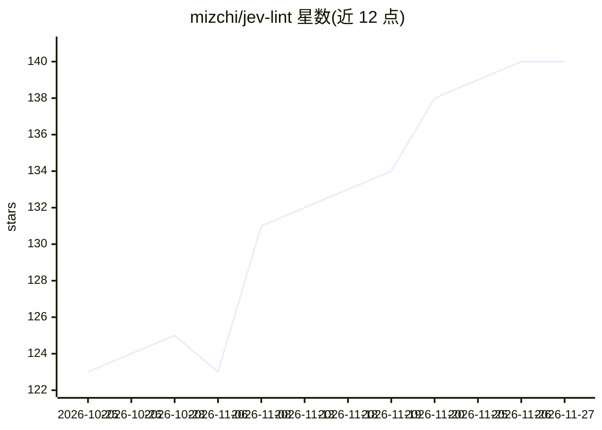

# mizchi/jev-lint

⭐ 140 · TypeScript · MIT · 推送 2026-11-21 · [GitHub](https://github.com/mizchi/jev-lint) · 个人维护

**用 Jev 分类模型对代码做语义 lint 的 CLI 工具**

基于 Node.js 的 lint 工具：每条规则是一句自然语言问题，由 ast-grep 匹配器选取代码片段，模型对该片段回答一个校准概率，超过阈值即报 finding。内置 121 条规则（68 个规则 ID），覆盖名称与行为一致性、注释与代码矛盾、测试承诺、shell 脚本对机器的操作、commit message 与 diff 的对应等编译器和 ESLint 无法判定的内容。通过 npx 运行，被判定代码会发送到 API；无 API key 时可离线预览规则与定价。

## 筛选速览

| 维度 | 判定 | 备注 |
|---|---|---|
| AI 角色 | `ai-native` | 本体是模型或模型工具 |
| 许可风险 | `permissive` | MIT |
| 部署形态 | `library` | 以包/库形式分发 |
| 模型依赖 | locked-api |  |
| 硬件要求 | — | 无带数字的原话,不猜 |
| 安装摩擦 | `low` | 无编译、无系统依赖或容器化 |
| 成熟度 | — | 结构信号不足 |

## 能力要点

- 121 条规则以一句自然语言问题驱动，模型以校准概率回答并按阈值报 finding
- ast-grep 匹配器决定检查范围，本地仅运行匹配器
- 支持 diff 范围 review、commit message 对照 diff、AGENTS.md 规则校验
- 离线 --dry-run 预览请求与成本，CI 可用提交缓存无 key 运行

## 适用场景

- 在 CI 中检查 PR 注释、命名与实际代码行为的矛盾
- 用自然语言写自定义 lint 规则检查自家代码约定
- 审查 shell 脚本是否做了读者不可见的危险操作
- 校验 commit message 与 diff、仓库自写指令的一致性

## 场景标签

`代码审查` · 领域:编码与开发

## 证据(README 行号)

> L5: A lint tool that uses Jev -- a fast classifier that
> L47: A jev-lint rule is one sentence. An ast-grep
> L51: sent to an API**, which is what the key pays for; nothing runs locally except

## 星数曲线

2026-10-25 123 → 2026-11-27 140（+17）

---
*卡片 v1 · prompt 1.4 · 生成 2026-11-27 · 置信度 high · 依据 README sha `d5d530ab73dc` · [字段定义](../../DATASET.md)*
