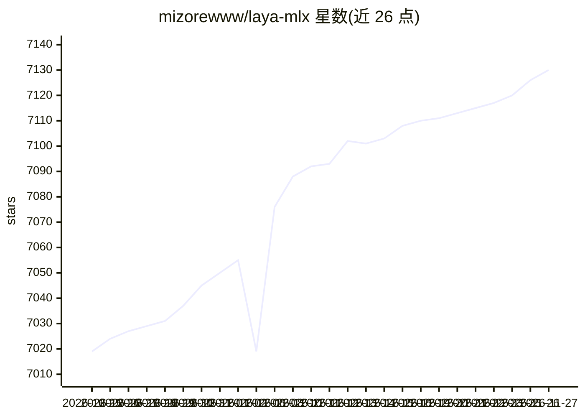

# mizorewww/laya-mlx

⭐ 7,130 · Python · Apache-2.0 · 推送 2026-11-26 · [GitHub](https://github.com/mizorewww/laya-mlx) · [官网](https://pypi.org/project/laya-mlx/) · 个人维护 · 中文 README

**面向开发者的 MLX 原生决策模型运行时，毫秒级约束判断**

Laya 类型化决策模型的 MLX 独立移植版，在 Apple Silicon 上本地运行原版权重：通过单次双向前向传播，对选择题、评分量规、真伪命题三类约束问题输出校准概率，不生成 token、不依赖 PyTorch、Transformers 或云端 API。支持语言路由、批量预测、置信度门控、大选项集短路/淘汰机制，提供 CLI、HTTP 服务与 MCP 入口，另附贪吃蛇演示。限制：仅限 Apple Silicon 与 macOS 14+，不含训练与 CUDA/ONNX 后端，非 Convai 官方发布。

## 筛选速览

| 维度 | 判定 | 备注 |
|---|---|---|
| AI 角色 | `ai-native` | 本体是模型或模型工具 |
| 许可风险 | `permissive` | Apache-2.0 |
| 部署形态 | `library` | 以包/库形式分发 |
| 模型依赖 | — | README 未给出锁定关系 |
| 硬件要求 | — | 无带数字的原话,不猜 |
| 安装摩擦 | `medium` | 含编译或系统依赖之一 |
| 成熟度 | — | 结构信号不足 |

## 能力要点

- choice/score/noul 三类问题输出校准概率，单次前向完成
- 语言路由器自动检测语言并在至多两个检查点间驻留切换
- CLI、HTTP、MCP 三种服务入口及 LangChain/LlamaIndex/CrewAI/Agno 集成（extras 安装）
- 三个预转换 MLX 检查点（421M/322M）附校验和与上游验证记录

## 适用场景

- 在 Mac 应用中本地做选项分类或量规打分
- 对是/否命题获得带置信度的概率判断
- 在游戏中高频调用决策（如贪吃蛇每步三问）
- 为 agent 框架提供低延迟本地决策后端

## 场景标签

`推理引擎` · 领域:训练与推理

## 证据(README 行号)

> L7: Laya answers constrained questions (pick an option, score against a rubric, judge true or
> L10: Laya weights in MLX,
> L19: Requires Apple Silicon, macOS 14+ and Python 3.11+.

## 星数曲线

2026-10-25 7,019 → 2026-11-27 7,130（+111）

---
*卡片 v1 · prompt 1.4 · 生成 2026-11-27 · 置信度 high · 依据 README sha `8b0cd636cf7f` · [字段定义](../../DATASET.md)*
