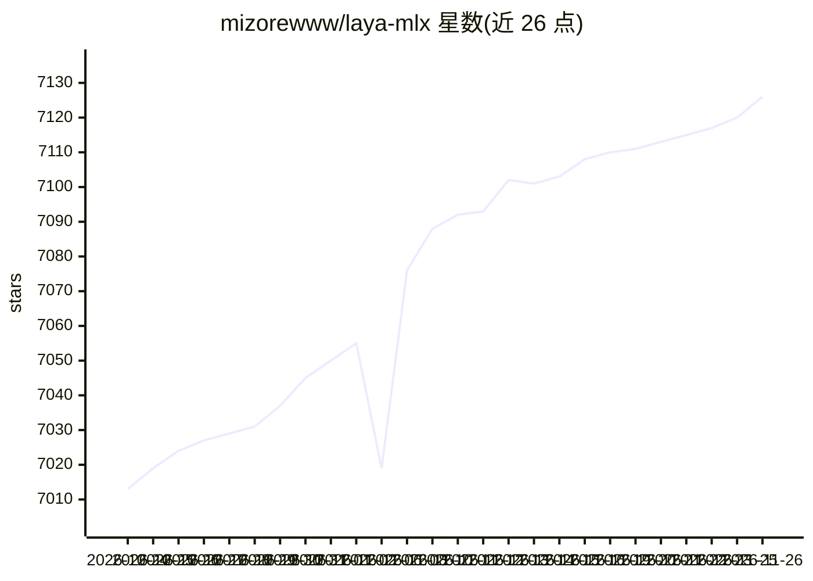

# mizorewww/laya-mlx

⭐ 7,126 · Python · Apache-2.0 · 推送 2026-11-25 · [GitHub](https://github.com/mizorewww/laya-mlx) · [官网](https://pypi.org/project/laya-mlx/) · 个人维护 · 中文 README

**在 Apple Silicon 本地运行 Laya 类型化决策模型的 MLX 运行时**

将 Laya 开放权重模型移植到 MLX 的本地运行时：以单次双向前向传播对受限问题（选项挑选、量表打分、真伪判定）输出校准概率，不生成文本、不需要 PyTorch/Transformers 或云 API。支持语言路由、批量与长文档推理、置信度门槛、大选项集预筛与锦标赛、CLI/HTTP/MCP 服务及 LangChain 等集成。仅限 Apple Silicon 与 macOS 14+；为独立移植，训练与微调不在此包范围内。

## 筛选速览

| 维度 | 判定 | 备注 |
|---|---|---|
| AI 角色 | `ai-native` | 本体是模型或模型工具 |
| 许可风险 | `permissive` | Apache-2.0 |
| 部署形态 | `library` | 以包/库形式分发 |
| 模型依赖 | — | README 未给出锁定关系 |
| 硬件要求 | — | 无带数字的原话,不猜 |
| 安装摩擦 | `medium` | 含编译或系统依赖之一 |
| 成熟度 | — | 结构信号不足 |

## 能力要点

- 单次前向传播输出校准概率，无 token 生成与 JSON 解析
- M3 Max 上短问题中位延迟 13.4 ms（多语言检查点 7.4 ms）
- 提供 CLI、HTTP、MCP 服务与 LangChain/LlamaIndex/CrewAI/Agno 集成 extras
- 三个预转换 MLX 检查点附模型卡、校验结果与校验和

## 适用场景

- 在 Mac 本地对分类/打分/判定类问题做低延迟推理
- 为 agent 工作流提供本地确定性决策输出
- 用置信度门槛筛出需人工复核的低置信回答
- 玩 Snake demo 观察模型实际决策速度

## 场景标签

`推理引擎` · 领域:训练与推理

## 证据(README 行号)

> L7: Laya answers constrained questions (pick an option, score against a rubric, judge true or
> L19: Requires Apple Silicon, macOS 14+ and Python 3.11+.

## 星数曲线

2026-10-24 7,013 → 2026-11-26 7,126（+113）

---
*卡片 v1 · prompt 1.4 · 生成 2026-11-23 · 置信度 high · 依据 README sha `0cd71f67a64d` · [字段定义](../../DATASET.md)*
