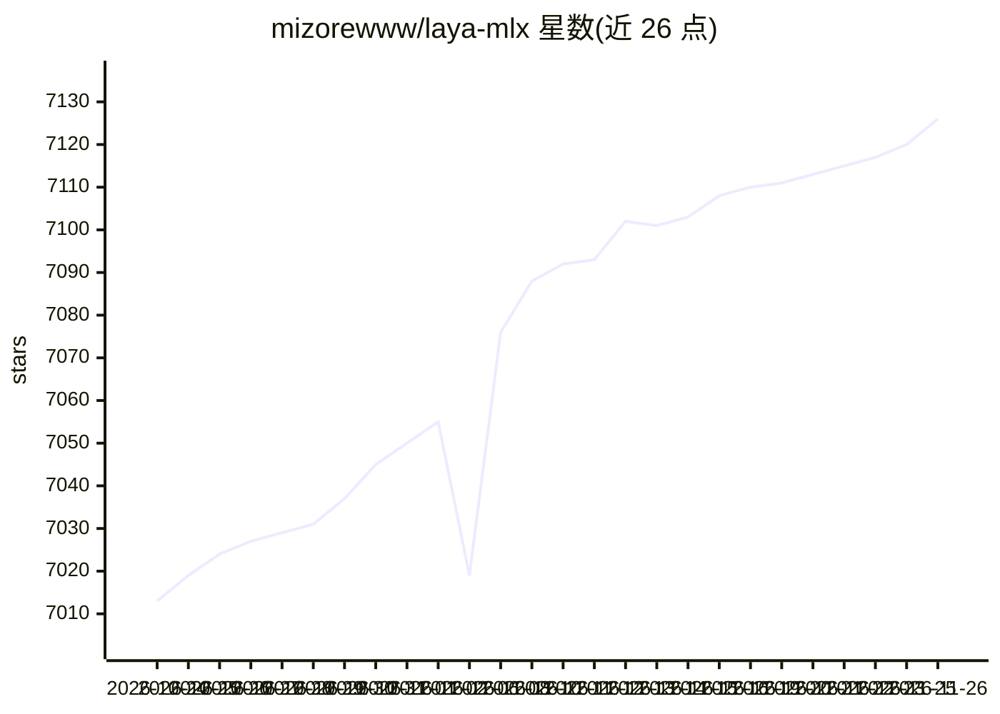

# mizorewww/laya-mlx

⭐ 7,126 · Python · Apache-2.0 · 推送 2026-11-25 · [GitHub](https://github.com/mizorewww/laya-mlx) · [官网](https://pypi.org/project/laya-mlx/) · 个人维护 · 中文 README

**开发者在 Apple Silicon 本地运行 Laya 类型化决策模型推理**

Laya-MLX 是将 Laya 决策模型权重以 MLX 原生运行的推理包：通过单次双向前向传播对约束问题（选项选择、量规打分、真假判断）输出校准概率，不生成 token、无需解析 JSON、不依赖 PyTorch 或云 API。提供 choice/score/noul 三类问题接口、语言路由、批处理、置信度门槛、大选项集短路/锦标赛，以及 CLI、HTTP、MCP 服务和 LangChain/LlamaIndex/CrewAI/Agno 集成。限制：仅支持 Apple Silicon、macOS 14+、Python 3.11+；CUDA、ONNX、训练不在范围内。

## 筛选速览

| 维度 | 判定 | 备注 |
|---|---|---|
| AI 角色 | `ai-native` | 本体是模型或模型工具 |
| 许可风险 | `permissive` | Apache-2.0 |
| 部署形态 | `library` | 以包/库形式分发 |
| 模型依赖 | — | README 未给出锁定关系 |
| 硬件要求 | — | 无带数字的原话,不猜 |
| 安装摩擦 | `medium` | 含编译或系统依赖之一 |
| 成熟度 | — | 结构信号不足 |

## 能力要点

- 单次双向前向输出校准概率，不生成 token
- M3 Max 上短决策中位 13.4 ms，多语种检查点 7.4 ms
- 提供 CLI、HTTP 服务、MCP 服务器与主流 agent 框架集成
- 语言路由自动检测语言并选择检查点

## 适用场景

- 本地毫秒级约束决策（选项选择/打分/判断）
- 游戏 AI 决策（README 提供 Snake 演示）
- 在 LangChain/LlamaIndex 等框架中作为决策组件接入

## 场景标签

`推理引擎` · 领域:训练与推理

## 证据(README 行号)

> L7: Laya answers constrained questions (pick an option, score against a rubric, judge true or
> L8: false) with calibrated probabilities from one bidirectional forward pass. It generates no
> L11: without PyTorch, Transformers or a cloud API.

## 星数曲线

2026-10-24 7,013 → 2026-11-26 7,126（+113）

---
*卡片 v1 · prompt 1.4 · 生成 2026-11-26 · 置信度 high · 依据 README sha `06f955c3ad1b` · [字段定义](../../DATASET.md)*
