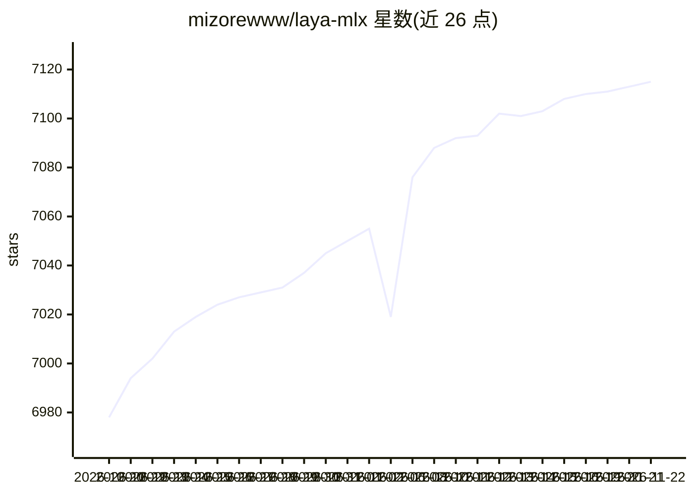

# mizorewww/laya-mlx

⭐ 7,115 · Python · Apache-2.0 · 推送 2026-11-21 · [GitHub](https://github.com/mizorewww/laya-mlx) · [官网](https://pypi.org/project/laya-mlx/) · 个人维护 · 中文 README

**在 Apple Silicon 上本地运行 Laya 类型化决策模型的 MLX 运行时**

将 Laya 权重移植到 MLX 的独立推理运行时，用一次双向前向传播对受限问题（选项选择、量表打分、真伪判断）输出校准概率，不生成文本、不依赖 PyTorch/Transformers/云 API。支持语言路由、批量预测、置信度门槛、大选项集短路/锦标赛筛选，附 CLI、HTTP 服务、MCP 服务器与导出工具。要求 Apple Silicon、macOS 14+ 与 Python 3.11+；README 声明这是非官方移植，训练与微调不在范围内。

## 筛选速览

| 维度 | 判定 | 备注 |
|---|---|---|
| AI 角色 | `ai-native` | 本体是模型或模型工具 |
| 许可风险 | `permissive` | Apache-2.0 |
| 部署形态 | `library` | 以包/库形式分发 |
| 模型依赖 | — | README 未给出锁定关系 |
| 硬件要求 | — | 无带数字的原话,不猜 |
| 安装摩擦 | `medium` | 含编译或系统依赖之一 |
| 成熟度 | `idea` | |

## 能力要点

- choice/score/noul 三类受限问题一次前向输出校准概率
- MLX 原生运行，无 PyTorch 与云 API，首次加载后完全本地推理
- 语言路由可注册自有检查点并常驻最多两个
- 提供 CLI、HTTP 服务、MCP 服务器及 LangChain/LlamaIndex/CrewAI/Agno extras 集成

## 适用场景

- 在 Mac 上离线运行带概率的选项选择与真伪判断
- 游戏代理等场景的低延迟本地决策（如 Snake 演示）
- 为工作流暴露决策模型的 CLI/HTTP/MCP 接口

## 场景标签

`推理引擎` · 领域:训练与推理

## 证据(README 行号)

> L7: Laya answers constrained questions (pick an option, score against a rubric, judge true or
> L10: Laya weights in MLX,
> L13: **13.4 ms** median for a short English decision, **7.4 ms** with the multilingual checkpoint (M3 Max, FP16).

## 星数曲线

2026-10-20 6,978 → 2026-11-22 7,115（+137）

---
*卡片 v1 · prompt 1.4 · 生成 2026-11-22 · 置信度 high · 依据 README sha `bf74d6422740` · [字段定义](../../DATASET.md)*
