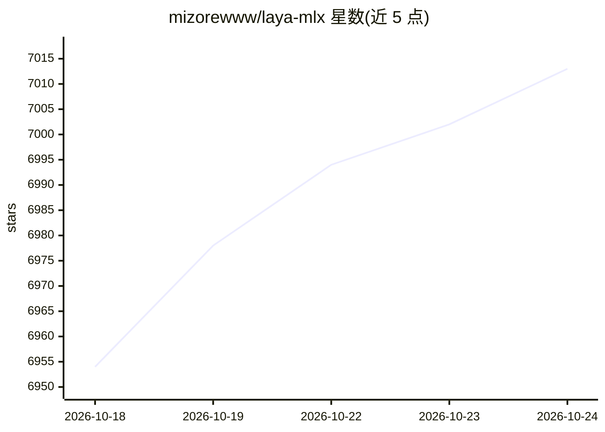

# mizorewww/laya-mlx

⭐ 7,019 · Python · Apache-2.0 · 推送 2026-10-20 · [GitHub](https://github.com/mizorewww/laya-mlx) · [官网](https://pypi.org/project/laya-mlx/) · 个人维护 · 中文 README

**Laya 类型化决策模型的 MLX 本地推理运行时（Apple Silicon）**

将 Convai Innovations 的 Laya 类型化决策模型（421M 英文 / 322M 多语等三个检查点）移植到 Apple Silicon 的 MLX 运行时，输出 choice 概率、score 评分、noul 真值判断，无 token 生成、无 PyTorch、无云 API。提供 Python API、CLI、Router 多检查点路由、语言检测、大候选集 shortlist 与置信度弃答门控；附带 Snake 终端演示。M3 Max 上短问题 P50 为 13.42ms/7.39ms，三检查点在 63 题验证集上与上游 FP32/FP16 全部一致。需 Apple Silicon、macOS 14+、Python 3.11+；为独立移植版而非官方发布。

## 筛选速览

| 维度 | 判定 | 备注 |
|---|---|---|
| AI 角色 | `ai-native` | 本体是模型或模型工具 |
| 许可风险 | `permissive` | Apache-2.0 |
| 部署形态 | `library` | 以包/库形式分发 |
| 模型依赖 | — | README 未给出锁定关系 |
| 硬件要求 | — | 无带数字的原话,不猜 |
| 安装摩擦 | `low` | 无编译、无系统依赖或容器化 |
| 成熟度 | — | 结构信号不足 |

## 能力要点

- 双向编码器一次前向产出类型化决策，无 token 解码，M3 Max P50 13.4ms（多语 7.4ms）
- 三检查点在 63 题验证集 378 次比较中与上游选中答案全部一致
- Router 多检查点路由、语言检测与未定语言回退多语模型
- predict_shortlist 嵌入式短名单处理数百标签的选择题，置信度弃答门控

## 适用场景

- 在 Mac 上本地获取选项概率、量表评分或命题真值判断
- 低延迟决策场景（如游戏/Agent 循环内的每步决策）
- 替代文本生成模型完成结构化受限决策，避免解析生成 JSON

## 场景标签

`推理引擎` · 领域:训练与推理

## 证据(README 行号)

> L7: **13.4 ms** median end-to-end for a short English typed decision. **7.4 ms** with the multilingual checkpoint. **0 o
> L61: - `choice`: probabilities over named options.
> L62: - `score`: probabilities over ordered rubric levels and their expected score.

## 星数曲线

2026-10-18 6,954 → 2026-10-24 7,013（+59）

---
*卡片 v1 · prompt 1.4 · 生成 2026-10-20 · 置信度 high · 依据 README sha `3b0162ce543b` · [字段定义](../../DATASET.md)*
