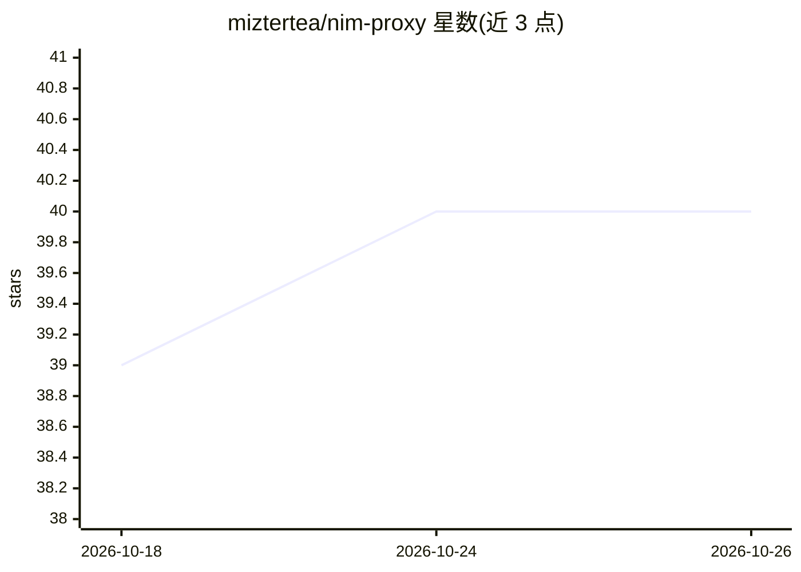

# miztertea/nim-proxy

⭐ 40 · Rust · MIT · 推送 2026-10-22 · [GitHub](https://github.com/miztertea/nim-proxy) · [官网](https://github.com/miztertea/nim-proxy) · 个人维护

**面向 NVIDIA NIM API 的 OpenAI 兼容限流代理，含监控面板**

用 Rust 编写的自托管代理：转发 OpenAI 格式请求到 NVIDIA NIM API，通过每 key 精确滑动窗口（40 RPM）、全局 FIFO 队列、SSE 心跳与跨 key 故障转移，使 OpenCode、Codex、n8n 等客户端不因 429 中断任务；支持多 key 池、粘性会话保持前缀缓存、模型压力感知退避。内嵌五页监控面板（Overview/Models/Clients/Reliability/Capacity），从计数与尺寸（非内容）观测请求量、TTFT、工具调用强度等。首次访问者成为超级用户并完成安装向导；Docker 镜像约 5 MB，也可 compose 或 cargo 源码运行。

## 筛选速览

| 维度 | 判定 | 备注 |
|---|---|---|
| AI 角色 | `ai-ecosystem` | LLM/agent 周边工具 |
| 许可风险 | `permissive` | MIT |
| 部署形态 | `self-host` | docker 或自建部署 |
| 模型依赖 | — | README 未给出锁定关系 |
| 硬件要求 | — | 无带数字的原话,不猜 |
| 安装摩擦 | `low` | 无编译、无系统依赖或容器化 |
| 成熟度 | — | 结构信号不足 |

## 能力要点

- 每 key 滑动窗口限流 + 全局 FIFO 队列 + SSE 心跳替代失败
- 多 key 池管理与跨 key 即时故障转移，粘性会话保前缀缓存
- 编译期内嵌五标签页监控面板：TTFT/延迟分解/容量利用率/SLO 错误预算
- 支持 keyed/open 两种客户端认证模式与绝对截止时间头

## 适用场景

- 让 OpenCode/Codex/n8n 等 agent 在 NIM 免费层 40 RPM 限制下持续运行
- 多人共享自有 NIM key 池并观测各客户端行为
- 对 NIM 上模型做基准测试与延迟/可靠性观测

## 场景标签

`模型网关` `LLM 可观测性` · 领域:Agent 开发

## 证据(README 行号)

> L5: **A tiny, rate-limit-aware OpenAI-compatible proxy for the NVIDIA NIM API.**
> L17: NIM's free tier has no credits and no token caps — just a ~40 requests-per-minute limit per API key. When a client 

## 星数曲线

2026-10-18 39 → 2026-10-26 40（+1）

---
*卡片 v1 · prompt 1.4 · 生成 2026-10-25 · 置信度 high · 依据 README sha `594cb23fca46` · [字段定义](../../DATASET.md)*
