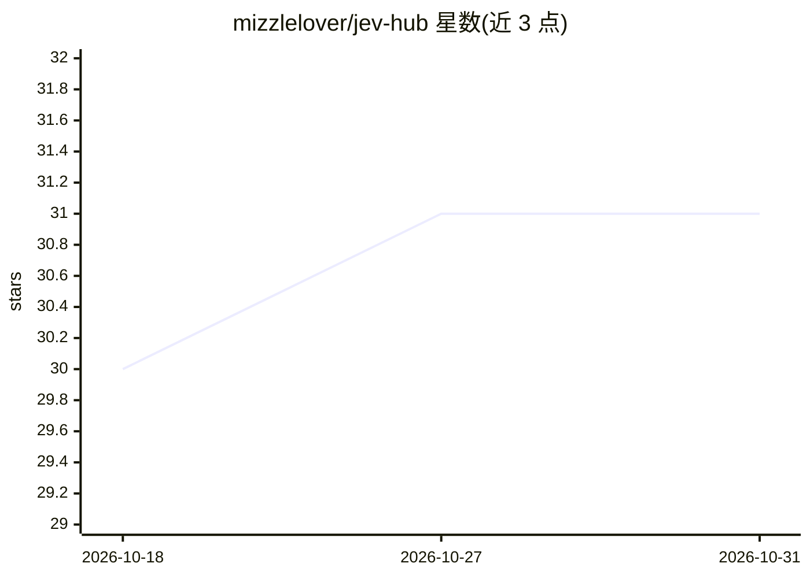

# mizzlelover/jev-hub

⭐ 31 · CSS · NOASSERTION · 推送 2026-09-21 · [GitHub](https://github.com/mizzlelover/jev-hub) · [官网](https://mizzlelover.github.io/jev-hub/) · 组织维护 · 中文 README

**X 上关于 TypeSafe AI「系统一模型」Jev 的内容聚合站**

由「谁是专家」出品的 Jev 相关内容聚合仓库：收录 X（Twitter）上关于 TypeSafe AI「系统一模型」Jev 的动态 982 条（演示视频 382、长文 147、讨论 453，参与作者 818），逐条保留原帖链接与作者署名，不转载、不二次托管内容。提供聚合网页与结构化数据 data/posts.json，数据跨度约一周，含按互动量排序的编辑精选与小白入门科普导航。覆盖英文、中文、日文等多语言内容。

## 筛选速览

| 维度 | 判定 | 备注 |
|---|---|---|
| AI 角色 | `ai-knowledge` | 知识聚合/清单类 |
| 许可风险 | `none` | NOASSERTION |
| 部署形态 | `library` | 以包/库形式分发 |
| 模型依赖 | — | README 未给出锁定关系 |
| 硬件要求 | — | 无带数字的原话,不猜 |
| 安装摩擦 | `low` | 无编译、无系统依赖或容器化 |
| 成熟度 | — | 结构信号不足 |

## 能力要点

- 聚合 982 条 Jev 相关 X 动态，含 382 条演示视频与 147 篇长文
- 逐条保留原帖链接与作者署名，不转载不二次托管
- 提供聚合网页与结构化数据 data/posts.json
- 按互动量做编辑精选，并提供小白入门科普导引

## 适用场景

- 跟踪 Jev 模型的演示视频、长文与社区讨论
- 了解 Jev 的应用场景与原理科普
- 通过结构化 JSON 数据做二次分析

## 场景标签

`精选清单` · 领域:学习与行业

## 证据(README 行号)

> L3: > X（Twitter）上关于 **TypeSafe AI「系统一模型」Jev** 的长文与演示视频聚合。
> L4: > 逐条保留**原帖链接**与**作者署名**，本站不转载、不二次托管任何内容。

## 星数曲线

2026-10-18 30 → 2026-10-31 31（+1）

---
*卡片 v1 · prompt 1.4 · 生成 2026-10-26 · 置信度 mid · 依据 README sha `8e971b266e85` · [字段定义](../../DATASET.md)*
