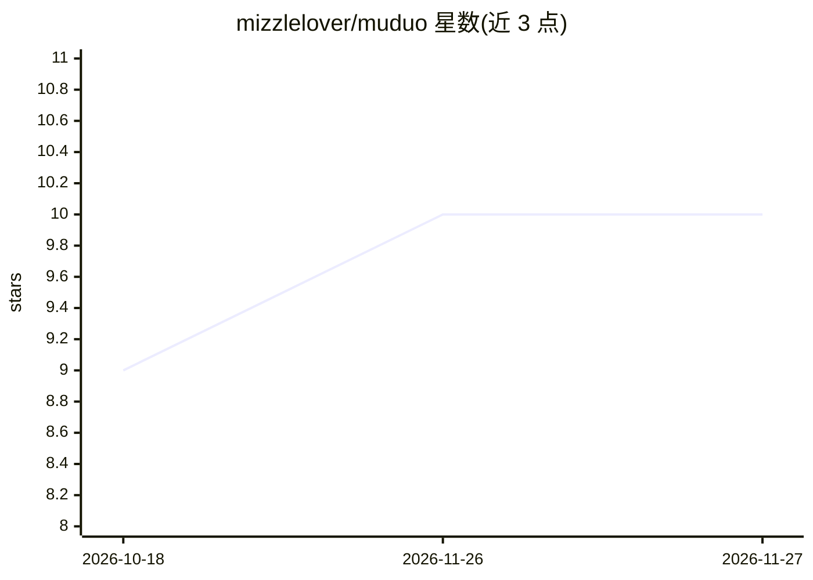

# mizzlelover/muduo

⭐ 10 · HTML · MIT · 推送 2026-10-08 · [GitHub](https://github.com/mizzlelover/muduo) · [官网](https://skill.mizzlelover.xyz) · 个人维护 · 中文 README

**给 AI Agent 调用的传播诊断与社群增长方法论知识库**

以 Agent Skills 标准封装的传播方法论知识库：内置 216 个机制节点（32 域、1200 条边）、13 个中文/海外平台适配器、A–E 证据等级体系与复制危机敏感清单，支持内容诊断、标题改写、长文优化、社群诊断、传播复盘等 11 个工作流。安装方式是把目录复制进 Claude Code、Codex CLI、OpenCode、Trae 等宿主的技能目录；对话调用零依赖，运行 scripts 工具需 Python 3.9+ 与 PyYAML。评测含 208 个自评案例与 33 案外部盲测。

## 筛选速览

| 维度 | 判定 | 备注 |
|---|---|---|
| AI 角色 | `ai-knowledge` | 知识聚合/清单类 |
| 许可风险 | `permissive` | MIT |
| 部署形态 | `None` |  |
| 模型依赖 | — | README 未给出锁定关系 |
| 硬件要求 | — | 无带数字的原话,不猜 |
| 安装摩擦 | `low` | 无编译、无系统依赖或容器化 |
| 成熟度 | — | 结构信号不足 |

## 能力要点

- 216 个机制节点，每条建议附带机制依据、证据等级 A–E 与适用边界
- 13 个平台适配器，平台事实四级标注并与理论层隔离
- 遵循 Agent Skills 开放标准（SKILL.md），兼容多种编码 Agent
- 208 案例 self-eval 与 33 案外部双盲测，评分协议公开

## 适用场景

- 让 Agent 诊断标题、首屏或整篇内容为什么传播不动
- 为公众号深度长文做论证地图与证据审计
- 诊断沉寂社群的结构性问题并设计活动
- 传播数据复盘时先排除分发与受众等外生变量

## 场景标签

`AI 写作` `知识库管理` · 领域:内容生成

## 证据(README 行号)

> L8: **一套证据感知型的传播方法论 Skill——让 AI Agent 学会诊断"为什么传播 / 为什么不传播"，
> L176: 本 Skill 遵循 **Agent Skills 开放标准**（`SKILL.md` 入口），主流编码 Agent 原生兼容，
> L238: ├── knowledge/          # 216 机制节点（32 域）· 210 来源（206 份 Evidence Package）· 冲突登记 · 经典复核 · 案例 · 反模式

## 星数曲线

2026-10-18 9 → 2026-11-27 10（+1）

---
*卡片 v1 · prompt 1.4 · 生成 2026-11-26 · 置信度 high · 依据 README sha `efe159066eaa` · [字段定义](../../DATASET.md)*
