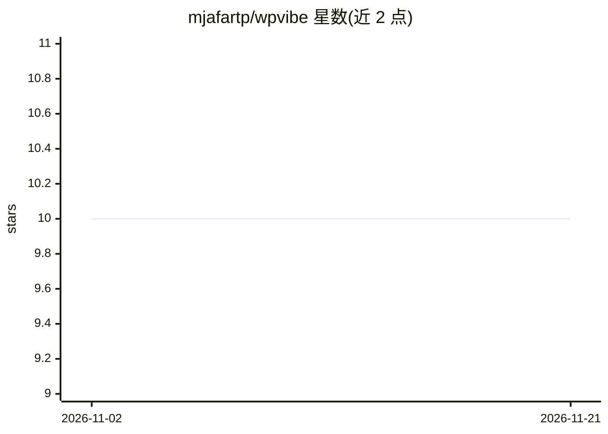

# mjafartp/wpvibe

⭐ 10 · PHP · GPL-2.0 · 推送 2026-04-10 · [GitHub](https://github.com/mjafartp/wpvibe) · [官网](https://www.wpvibe.net) · 个人维护

**面向 WordPress 用户的 AI 主题生成插件，对话即可产出主题**

一个开源 WordPress 插件，把 wp-admin 变成分屏式 AI 主题工作室：左侧对话输入自然语言提示、上传设计图或连接 Figma 取帧，右侧 iFrame 实时预览。AI 按会话生成 style.css、functions.php、theme.json 等多文件主题，支持增量更新、版本快照与撤销/重做、ZIP 导出。应用与导出前自动运行 AI 安全扫描（RCE/SQL 注入/XSS 等），API key 经 AES-256-CBC 加密存储、仅服务端 PHP 调用。需 WordPress 6.3+ 与 PHP 8.1+，HTTPS 必需。

## 筛选速览

| 维度 | 判定 | 备注 |
|---|---|---|
| AI 角色 | `ai-native` | 本体是模型或模型工具 |
| 许可风险 | `viral` | GPL-2.0 |
| 部署形态 | `desktop` | 安装包/桌面程序 |
| 模型依赖 | locked-api |  |
| 硬件要求 | — | 无带数字的原话,不猜 |
| 安装摩擦 | `low` | 无编译、无系统依赖或容器化 |
| 成熟度 | — | 结构信号不足 |

## 能力要点

- 自然语言/设计图/Figma 三种输入方式生成多文件主题
- 流式 SSE 输出与 iFrame 实时预览（移动/平板/桌面视口）
- AI 安全扫描与一键修复，版本快照支持撤销与恢复
- BYOK 自带 Anthropic/OpenAI/Gemini key 或 WP Vibe 积分

## 适用场景

- 不写代码为 WordPress 站点生成自定义主题
- 根据设计稿或 Figma 帧还原成 WordPress 主题
- 在 wp-admin 内迭代调整主题样式并导出 ZIP

## 场景标签

`代码生成` · 领域:编码与开发

## 证据(README 行号)

> L16: WP Vibe is a free, open-source WordPress plugin that turns your WordPress admin into a **split-screen AI theme stud
> L34: - **Natural language prompts** — describe any design in plain text
> L46: ### Multi-Provider AI Support

## 星数曲线

2026-11-02 10 → 2026-11-21 10（+0）

---
*卡片 v1 · prompt 1.4 · 生成 2026-11-19 · 置信度 mid · 依据 README sha `db41688b2c4b` · [字段定义](../../DATASET.md)*
